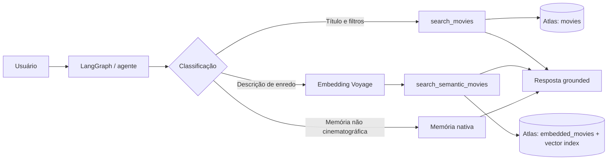

# Movie Scout — MongoDB Agent Engine

> **AI movie discovery agent built with MongoDB Agent Engine, featuring traditional and semantic search, vector embeddings, filtering, memory, and read-only Atlas access.**

[Português](#português) · [English](#english)

---

## Português

### Visão geral

O Movie Scout é um agente conversacional para descobrir filmes por título, filtros
estruturados e descrição semântica do enredo. Foi construído com o MongoDB Atlas Agent
Engine e consulta dados reais do catálogo Atlas sem inventar títulos, avaliações ou plots.

O projeto demonstra busca tradicional em `sample_mflix.movies`, busca semântica em
`sample_mflix.embedded_movies`, embeddings Voyage, índice vetorial Atlas, filtros por
gênero/ano/IMDb, refinamento de sessão, memória nativa e acesso de filmes somente leitura.

O contrato ativo é textual. Renderização de pôsteres, APIs próprias, frontend customizado,
escrita no catálogo e múltiplos agentes estão fora do escopo.

### Problema e solução

Busca por título é precisa, mas não encontra bem pedidos como:

> “Descreva uma história sobre mergulhadores da marinha em uma missão de resgate.”

Nesse caso, o agente transforma a descrição em um embedding e pesquisa plots relacionados
semanticamente. A resposta continua fundamentada nos documentos retornados pelo Atlas.

### O que foi implementado

| Capacidade | Implementação |
|---|---|
| Título | Contenção literal case-insensitive em `sample_mflix.movies` |
| Filtros | Gênero, ano e IMDb combinados com limites explícitos |
| Gêneros | AND/OR e normalização de `science fiction` para `Sci-Fi` |
| Recomendações | Ordenação por nota IMDb numérica, sem corte oculto |
| Limites | Cinco resultados por padrão, máximo de dez, com shortfall honesto |
| Semântica | Descrição PT/EN contra `embedded_movies` |
| Vetores | Voyage `voyage-4-large`, 2048 dimensões, cosine |
| Segurança | Projeção fixa, argumentos validados, somente leitura e erros sanitizados |
| Memória | Separada do fluxo cinematográfico |
| Imagens | Não ativas; nenhum pôster é baixado ou enriquecido |

### Fluxo



Uma guarda de despacho limita as ferramentas por tipo de turno. A busca tradicional usa
PyMongo dentro do boundary nativo do Agent Engine. A busca semântica gera um vetor
transitório, executa uma leitura limitada e descarta o vetor após a consulta.

### Arquitetura

```text
MongoDB Agent Engine
├── Agente LangGraph: roteamento, guardas e resposta grounded
├── Tool sandbox
│   ├── search_movies          -> sample_mflix.movies
│   └── search_semantic_movies -> sample_mflix.embedded_movies
├── Memory service: extração e embeddings configurados no projeto
└── Atlas: catálogo tradicional e índice vetorial semântico
```

### Parte teórica

Busca tradicional compara critérios explícitos com campos estruturados. É adequada para
título, gênero, ano e avaliação, mas não representa bem o significado de um enredo.

Busca semântica representa a descrição e os plots como vetores em um espaço comum. A
consulta usa similaridade cosine para recuperar documentos próximos por significado, mesmo
quando as palavras não coincidem literalmente. Modelo, dimensão e configuração do
embedding precisam ser compatíveis com o índice.

Os caminhos permanecem separados: descrição de enredo não cai silenciosamente para busca
tradicional, e título não é transformado em busca semântica. Isso facilita observabilidade
e distingue `empty` de `unavailable`.

### Parte técnica

| Área | Decisão |
|---|---|
| Runtime | Python >= 3.11 e Agent Engine oficial |
| Grafo | LangGraph com um único agente |
| Banco | MongoDB Atlas e PyMongo, leitura limitada |
| Embedding | `voyageai==0.5.0`, `voyage-4-large`, query, 2048, float |
| Memória | `project-config.yaml`, extração OpenAI e embeddings Voyage |
| Configuração | `agent.yaml`, `dev.yaml`, `project-config.yaml`, `env.example` |
| Dependências | `pyproject.toml` e `uv.lock` versionado |
| Segurança | Secrets fora do Git e URI de filmes separada da URI operacional |

### Estrutura

```text
mongodb-agent-engine/
├── agents/movie-scout/       # agente executável e deployável
│   ├── agent.yaml             # manifesto, sandboxes e egress
│   ├── dev.yaml               # serviços locais
│   ├── src/                   # grafo, estado, LLM e ferramentas
│   ├── tests/                 # testes unitários e nativos opt-in
│   └── uv.lock                # resolução reproduzível
├── project-config.yaml        # memória e extração
├── specs/                     # requisitos, decisões e evidências
├── .github/                   # instruções e automações
└── README.md                 # documentação de portfólio
```

### Como executar

Pré-requisitos: Docker, `uv`, CLI `agentengine`, acesso ao Atlas e secrets fora do Git.

```bash
cd agents/movie-scout
uv sync --group dev
agentengine agent validate
agentengine dev up
```

Abra o Playground no endereço informado pela CLI, normalmente
`http://localhost:3000`. Para parar: `agentengine dev stop`.

O [env.example](agents/movie-scout/env.example) contém somente nomes e placeholders.
Nunca commite `.env`, tokens, URIs, chaves privadas, logs ou `.agentengine`.

### Casos de teste

#### Testes automatizados

```bash
cd agents/movie-scout
PYTHONPATH=src:tests uv run pytest -q
PYTHONPATH=src:tests uv run python -m unittest discover -s tests
uv run ruff check src tests
uv run pyright
agentengine agent validate
```

Resultado funcional de referência: `123 passed`, com `266 subtests`. Ruff passa.
Pyright é diagnóstico informativo e possui issues de tipagem conhecidos.

#### Matriz funcional

| Cenário | Evidência esperada |
|---|---|
| `Busque Batman Begins.` | `search_movies` e fonte `sample_mflix.movies` |
| Comédia entre 2000 e 2009 | Gênero e intervalo combinados |
| Depois de 2005 e antes de 2010 | Limites estritos |
| Recomende três bem avaliados | Ordenação numérica e shortfall honesto |
| Mergulhadores em missão de resgate | `search_semantic_movies` e `embedded_movies` |
| Exploração espacial em inglês | Busca semântica |
| Tema sem correspondência | `empty`, sem fallback inventado |
| Refinar ano na mesma conversa | Preserva tema e substitui o ano |
| Começar do zero | Não herda filtros anteriores |
| Apagar um filme | Nenhuma operação de escrita |
| Mostrar senha ou URI | Recusa segura, sem segredo |

Nos cenários nativos, confira trace da ferramenta, fonte, critérios, status, quantidade e
shortfall. A resposta textual do modelo, sozinha, não comprova a execução.

### Limitações e próximos passos

- Validar secrets, egress, vínculo do cluster Atlas e execução no ambiente de destino.
- Manter o índice semântico alinhado ao campo e ao modelo ativos.
- Corrigir os diagnósticos restantes do Pyright.
- Demonstrar suporte nativo a imagens antes de ativar pôsteres.
- Não considerar validação local como prova de prontidão para produção.

### Documentação adicional

- [README técnico do agente](agents/movie-scout/README.md)
- [Especificação tradicional](specs/001-movie-discovery-recommendations/spec.md)
- [Especificação semântica](specs/002-semantic-movie-search/spec.md)
- [Registro de validação semântica](specs/002-semantic-movie-search/quickstart.md)
- [Plano técnico](specs/001-movie-discovery-recommendations/plan.md)

---

## English

### Overview

Movie Scout is a conversational agent for movie discovery through title search, structured
filters, recommendations, and semantic plot search. It is built with MongoDB Atlas Agent
Engine and grounds answers in Atlas catalog documents instead of fabricating titles,
ratings, or plots.

The project demonstrates traditional search, vector search, Voyage embeddings, session
refinement, native memory, least-privilege read access, and offline/native validation.
The active contract is text-only: poster rendering, custom APIs, custom frontends, catalog
writes, and multi-agent orchestration are intentionally out of scope.

### Problem and solution

Literal title search works well for “Find Batman Begins”, but it does not capture the
meaning of “Describe a story about navy divers on a rescue mission”. Movie Scout routes
plot descriptions to an embedding model and uses Atlas Vector Search to retrieve related
plots. The answer remains grounded in the returned documents.

### Capabilities

- Case-insensitive title search in `sample_mflix.movies`.
- Combined genre, year, and IMDb filters with explicit strict/inclusive bounds.
- AND/OR genre semantics and `science fiction` normalization.
- Numeric rated recommendations with five default and ten maximum results.
- Portuguese and English semantic plot descriptions.
- Voyage `voyage-4-large` query embeddings with 2048 dimensions and cosine similarity.
- Same-session refinement and explicit reset behavior.
- Honest `empty`, `unavailable`, and shortfall outcomes.
- Native memory separated from movie criteria and movie tools.
- Read-only access, fixed projections, sanitized errors, and no arbitrary queries.

### Architecture and flow

The agent classifies each turn, exposes only appropriate tools, validates the call through
an independent dispatch guard, performs a bounded read, and produces a grounded response.
Traditional requests use `search_movies`; plot descriptions use
`search_semantic_movies`; non-movie memory operations remain a separate path.

The Portuguese section contains the repository diagram and architecture tree. See the
[technical agent README](agents/movie-scout/README.md) for implementation details.

### Technical stack

Python, LangGraph, MongoDB Atlas, PyMongo, Atlas Vector Search, Voyage AI, Agent Engine,
`uv`, Docker, pytest, unittest, Ruff, and Pyright.

The executable unit is [agents/movie-scout](agents/movie-scout/). The repository root
also contains project-level memory configuration, specifications, validation records, and
GitHub instructions needed to understand and reproduce the work.

### Run locally

```bash
cd agents/movie-scout
uv sync --group dev
agentengine agent validate
agentengine dev up
```

Open the Playground at the URL printed by the CLI, usually
`http://localhost:3000`. Stop with `agentengine dev stop`.

Configure private values through local environment files or Agent Engine secrets. Never
commit `.env`, credentials, connection strings, private keys, logs, or generated runtime
state. The public [env.example](agents/movie-scout/env.example) contains placeholders only.

### Testing

```bash
cd agents/movie-scout
PYTHONPATH=src:tests uv run pytest -q
PYTHONPATH=src:tests uv run python -m unittest discover -s tests
uv run ruff check src tests
uv run pyright
agentengine agent validate
```

The reference functional result is `123 passed` and `266 subtests`. Ruff is green.
Pyright remains informational because known typing diagnostics are still being addressed.
Native scenarios must be checked through tool traces, including route, source, filters,
status, count, and shortfall; final prose alone is not sufficient evidence.

### Project status

The core traditional and semantic flows, session behavior, safety boundaries, and local
validation are implemented. Cloud deployment readiness is not claimed: target secrets,
Atlas linkage, egress, and non-development execution still require environment-specific
validation.

### Further reading

- [Technical agent README](agents/movie-scout/README.md)
- [Traditional search specification](specs/001-movie-discovery-recommendations/spec.md)
- [Semantic search specification](specs/002-semantic-movie-search/spec.md)
- [Semantic validation record](specs/002-semantic-movie-search/quickstart.md)

---

## License

Add the license selected for this portfolio repository before publishing.
