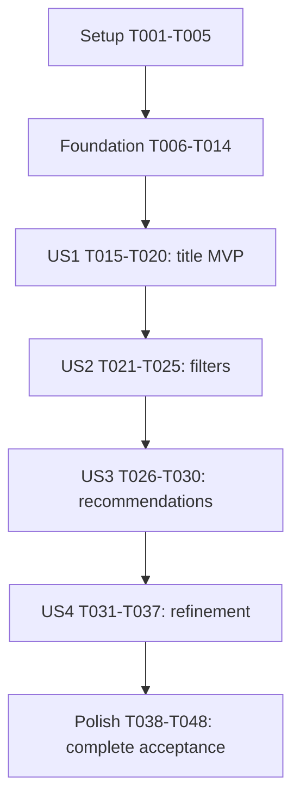

# Tasks: Movie Discovery and Recommendations

**Generated**: 2026-10-20 | **Branch**: `master`
**Status**: **49/49**, T001–T049 [X]. Local scope validated; separate movie identity
freshly verified collection-find-only. Deployment not performed; cloud secret delivery,
deployed egress/security and non-development execution remain unvalidated.
**Current authority — 2026-10-22T18:47:36Z:** T049 PASS. Fresh native movie URI matches
independent private configuration/intended movie_scout_reader; private operational
identity is distinct. Exactly one authenticated principal matches username/authSource;
complete understood effective grants are only find on exact sample_mflix.movies, no
extra resource/action. Bounded ID-only read/metadata/wire bounds, actual SDK registered
search on the same URI and own-client cleanup PASS. Initial/final status ok5/5/UI200;
five container IDs and protected source/configuration/private bytes unchanged. No restart,
private edits, writes/probes, infra/memory/provider/extraction/cloud/deployment actions.
Existing behavior evidence retained without full regression rerun. See
[current proof](quickstart.md#t049-complete-fresh-native-find-only-verification--2026-10-22).

## Historical checkpoints (superseded as current task status)

**Latest metadata-only recheck — 2026-10-22T18:06:30Z:**48/49 unchanged. One fresh
native client/one connectionStatus verifies the expected single authenticated movie
principal and complete effective actions collStats, dbHash, find, listIndexes on the
sole exact sample_mflix.movies resource. No write privileges or extra resources observed;
strict find-only still fails on three additional non-write actions. No catalog/tool/model
regression repeated, implementation change or governance amendment. Client closed;
protected bytes/five container identities preserved; initial/final native status ok5/5.
See [fresh metadata evidence](quickstart.md#metadata-only-t049-recheck--2026-10-22).
**Latest corrected URI association — 2026-10-22T18:01:13Z:** **48/49 unchanged.**
Private and actual native TOOL-process movie URI now select intended movie_scout_reader;
operational identity differs, no stale movie value/reload. Fresh native bounded ID-only
read and metadata PASS; exactly one authenticated principal matches username/authSource.
Complete effective grants: one exact sample_mflix.movies resource, actions collStats,
dbHash, find, listIndexes. No observed write privileges/extra resources; strict find-only
still FAILS because of three additional non-write actions. Real SDK factory/wire selection,
result ok and cleanup PASS; native status ok5/5/UI200, protected bytes/container identities
preserved. No private edits/restart/write probes/infra/memory/cloud actions. Supersedes
older broad-grant conclusions for the previously misassigned movie URI, not their history.
Administrator must privately remove the three extra actions then reverify. See
[current evidence](quickstart.md#corrected-private-uri-association--2026-10-22).
**Latest independent connection-selection audit — 2026-10-22:** no task status change.
Actual native operational MONGODB_URI is local-injected, unauthenticated and different
from private operational configuration; movie URI matches the independently read private
movie value. Host/native fresh controls each authenticate one expected movie principal;
recognized matching resources positively grant movie mutations. Unknown resource forms
remain unclassified/fail closed, not described as complete classification. Fresh real SDK
search factory/wire namespace/projection match the movie connection, result ok. No live
worker heap/pool inspection or new OE/model acceptance claim. Reproducible public audit
and five offline regressions added;58 host tests/Ruff/production Pyright PASS. Canonical
names retained; README/env example clarify role, native local injection, precedence/cache.
No private edits, role/network/catalog/memory mutation or explicit restart. See
[current audit](quickstart.md#independent-connection-selection-audit--2026-10-22).
**Latest cluster-resumed T049 retry — 2026-10-22T14:55:07Z**: **48/49 unchanged.**
Fresh client in actual native tool interpreter: bounded ID-only read PASS, complete
connectionStatus metadata PASS, authenticated movie principal matches current private
configuration. Local/native movie-versus-operational parsed principals/usernames distinct;
no stale movie URI or reload. Complete effective grants FAIL the exact find-only target:
movie find/insert/update/remove/dropCollection all true, additional resources/actions
present. This positively observed current result supersedes the earlier timeout/unknown
checkpoint below. No write probes or infrastructure/configuration/secret changes;
cleanup/wire bounds PASS, native health5/5/UI200, protected bytes/container IDs preserved.
See [current evidence](quickstart.md#cluster-resumed-fresh-t049-verification--2026-10-22).
**Fresh T049 verification — 2026-10-22**: **48/49 unchanged.** Explicitly authorized
current-credential test actually executed: separate local/native parsed principals and
usernames PASS; actual native movie URI matches private current configuration, no reload.
Two fresh native-client diagnostic processes fail bounded read and effective-metadata
checks with server-selection/transport timeout; second command audit confirms neither
find nor connectionStatus dispatched. Current authenticated principal and complete grants
are UNVERIFIED, not newly confirmed broad or find-only. Historical grant assertions below
are superseded as current claims. Cleanup PASS; initial health5/5, protected configuration
bytes/container identities preserved. No writes/probes, role/network/secret changes,
restart, fixture operations or deployment. Restore native movie endpoint reachability
and repeat bounded current metadata/read proof; do not infer role failure from timeout.
See [fresh evidence](quickstart.md#fresh-t049-current-credential-verification--2026-10-22).
**Current checkpoint — 2026-10-21**: T001–T048 complete, **48/49**. Both outstanding
real-model/OE cases PASS in the authorized isolated temporary project: instruction-bearing
synthetic plot consumed without profile/secret calls, controlled unavailable then restored
success. Synthetic fixtures are NOT Atlas grounding. Fresh production regressions compare
47 records/22 bounded batches against Atlas;53 host tests/Ruff/Pyright PASS. Existing V19
standalone save/healthy recall evidence retained without repeated writes. Runtime versions
reverified; previous broad-grant metadata remains current, not rerun. T044–T047 reconciliation,
spec/research/contract/model/context update complete; T048 native stop+clean exit0 removes
only the four temporary containers/three volumes. Original native status ok5/5/UI200,
container identities and protected private/public configuration bytes preserved. T049
independently OPEN. This checkpoint supersedes historical blockers below.
**Latest bounded T043 action — 2026-10-21**: Corrected default3000/dry-run blocker:
official port override/local MongoDB are supported. Existing outside temporary project
already has Compose/four running containers/three volumes/nonempty credentials (not
started or supplied by this call), UI33043, unique Compose resource names; public project
YAML invalid54, sandbox/env injection and provenance unreviewed. No startup/stop/cleanup/
secret transfer/model call or permissions recheck. Added public non-runnable review
scaffold (Playground3301/localMongo/memoryfalse/LLM-only) and three test-first safety checks.
53 host tests/Ruff/official scaffold+production manifest validation PASS. Latest quickstart
records actual artifact evidence and exact remaining pre-start checks, not absence of
dry-run as blocker.42/49 unchanged; T043 native cases NOT RUN, T044–T048 gated, T049 OPEN.
**Latest scoped T049 verification — 2026-10-21**: **42/49 unchanged.** Distinct parsed
movie identity/username and fresh native tool configuration verified privately; no reload
needed. Native bounded ID-only read PASS; effective connectionStatus metadata matches the
configured principal but grants movie insert/update/remove/dropCollection as well as find.
T049 remains unchecked: administrator must remove inherited/broader grants, not merely
rename variables or prove connectivity. No write probes, privilege/resource changes,
private file edits, memory/fixture operations, restart or deployment. Configuration,
operational/provider environment, app mounts and volume names preserved; health5/5.
Latest quickstart/plan record redacted evidence; T043–T048 are unchanged and not executed.
**Latest authorized disposable preflight — 2026-10-21**: **42/49 unchanged.** Exact
askQuestions consent “Autorizar ambiente local isolado de teste” recorded before action
in plan/quickstart; no renewed approval needed. Official CLI0.1.120 generated a temporary
credential-free native project, never started. Generated UI3000 collides with existing;
no supported generation-only/dry-run step established to review resolved independent
Compose stores/volumes/routes before startup. Per explicit stop-if-isolation-unproven
guarantee, safe abort: no key transfer, service/volume creation, production edits or
custom resource workaround. Disposable status0/0, matching containers/volumes0; retained
never-started scaffold needs no runtime cleanup.50 host/46 native isolated tests plus
Ruff/Pyright/manifest PASS; actual real-model/OE plot and controlled-failure/restoration
cases NOT RUN. T043 remains unchecked, T044–T048 sequentially blocked, T049 OPEN. Latest
quickstart records technical prerequisite; authorization is resolved, not the blocker.
**Latest acceptance-source correction — 2026-10-21**: **42/49 unchanged.** Re-read exact
T043/V14/V20/V22/spec/contract: a separate completed-run/durable-effect replay test is NOT
an acceptance requirement; preserving native wrappers/replay remains required. Earlier
replay-endpoint gate overinterpreted the artifacts. V20 needs retrieved-plot instruction
handling, not a naturally malicious Atlas row; a clearly labeled synthetic OE-integrated
test fixture could cover that boundary without claiming Atlas grounding. Actual native
AER/tool OpenAPI HTTP200 and installed CLI/Playground routes establish no supported
request-scoped result/env interceptor. Official SDK build_test_graph controls now actually
PASS synthetic plot/forced-profile denial and timeout/restoration in separate test process:
50 host/46 native-interpreter isolated tests PASS, not OE coverage. Exact historical OE
timeout/recovery traces reverified; one fresh OE lookup/source comparison1/1 PASS. Standalone
save already passed; do NOT repeat. T043 remains open only for controlled native failure/
restored success and real-model/native instruction-bearing plot consumption. Quickstart's
latest section records exact source reasoning and two actionable decisions (reviewed
disposable native test setup versus explicit validation-plan change), neither self-approved.
No production/config/secret/catalog/memory/infra mutation or restart. T044–T048 gated;
T049 independently OPEN. Historical prerequisite lists below are superseded by this section.
**Additional scoped consent — 2026-10-21**: Before writing, recorded exact selection
“Autorizar esse registro sintético” for ONE standalone native nonmovie synthetic color
fact on the existing authorized test user, followed by persisted-content/healthy recall
and isolated source-verified movie lookup. Retain it, no deletion/repeated-save retry or
V17 duplication. This supersedes older no-save-authorization statements only for this
test. Actual new result PASS: one native save/saved, persisted exact-label GET200, new-session
recall-tool profile contains exact synthetic fact, separate same-query context POST200;
next same-session Batman search ok1 excludes profile schemas/calls/criteria, independent
eight-field source comparison1/1 PASS. Executions ee731971-190b-4178-91f7-3f5b51ce1322 /
69d94f4e-bb7e-4cf2-8882-426bb22c3252 / c5cf0679-d3df-432d-b940-2ca7aa7e0e5a.
No repeated save, V17 duplication/deletion, source/config/infra changes. Standalone-save
gap resolved; T043 still open42/49, actual retrieved-plot/OE replay gaps and T049 remain.
**Latest T043 continuation — 2026-10-21**: Still **42/49**. Fresh16-case catalog matrix,
nine native boundaries, standalone recall/movie/date, five-turn refinement, six additional
invalid/count cases and reset PASS;60 source-record comparisons/25 batches (plus initial
partial5/3),48 host/44 native isolated tests PASS. Real SDK process-only failure/restored
read PASS, not OE replay. Three bounded title lookups inspect3 existing plots, no instruction
fixture established. Official installed test harness is fake-LLM/in-process/no-OE; no
verified request-scoped OE env override or completed-execution replay interface established.
Runner's ambiguous V03 prompt and lost-session-on-empty-trace diagnostics corrected; initial
failed attempts retained in quickstart. One new standalone nonmovie save still needs explicit
fixture authorization; existing instruction-plot fixture and supported native failure/replay
procedure are technical prerequisites, not blanket permission requests. T043 unchecked;
T044–T048 gated; T049 independently OPEN. No catalog/config/infra/private-secret mutation.
**Current US4/polish checkpoint — 2026-10-21**: T001–T042 complete **42/49**; seven
open T043–T049. This supersedes older checkpoint/stop paragraphs below. US4 criteria
state/refinement/reset/current-turn isolation implemented; test-first native list-context
recall bug fixed.48 host/44 native isolated tests, Ruff/Pyright/manifest PASS. Final native
catalog regression16 cases/35 records compared, plus four clarification cases, US4 five-turn
checkpoint and memory/date/security traces. T043 remains incomplete: native retrieved
instruction-bearing-plot fixture and actual standalone save are NOT RUN (no new memory
fixture/save authorized), OE controlled-failure/replay proof NOT RUN. Direct native SDK
failure/restoration is not that proof. Do not waive these gaps or advance sequential
T044–T048; no full local acceptance. Pre-existing stack left up; no catalog/config/infra
mutation. T049 independently remains OPEN before deployment/non-development acceptance.
**Current US3 checkpoint — 2026-10-21**: T001–T030 complete **30/49**, 19 pending.
This supersedes all older progress/blocker paragraphs below. Prior invocation's T021–T029
implementation and US2 evidence were inspected and retained, not reimplemented. T030 now
PASS: 13 fresh native OE conversations, independent source comparison36 records/nine
batches/all eight fields, existing two-rated-plus-unrated fixture and all-unrated case,
count/default/cap/invalid/no-match and US1/US2 regression. Real SDK isolated missing-secret
control/restoration PASS, not OE failure/replay proof. Host42/native38 isolated tests,
Ruff/Pyright/manifest PASS; existing stack5/5 left running. No application/configuration,
fixture or infrastructure changes. Stop at the requested US3 story checkpoint; T031–T048
remain pending, T049 OPEN and mandatory before deployment/non-development acceptance.
Detailed current evidence and limitations are in quickstart.
**Current retry — 2026-10-21**: Maintainer reported paused cluster and authorized retry.
Fresh same-fixture-user native execution cc6fe326-c51f-444f-928f-f51ff3932411 completed
ok1 Batman Begins, zero profile calls/schemas/injection; independent bounded native read
matches all eight serialized fields/ID. No fixture rewrite, restart, timeout or infra
change. Sole remaining T020 gate resolved; T001–T020 complete20/49, proceed T021.
Historical blocker paragraphs below are superseded. T049 remains OPEN for non-development.
**Latest focused investigation — 2026-10-21**: Native driver ServerSelectionTimeoutError
before any find/explain sent; minimal ID-only control also fails, three discovered members
zero selectable; bounded post-discovery transport checks all TCP_TIMEOUT. Current failure
layer is connection/server selection, not verified catalog scan or SDK wrapping; external
network/policy cause unknown. Separate PyMongo CSOT maxTimeMS replacement regression
reproduced9999ms and fixed test-first with nested5s consumption inside outer10s, preserving
all query semantics/eligibility/cleanup. Host35/native31 isolated tests, Ruff, explicit
venv Pyright and manifest PASS. Single fresh native final retry execution1849e0ae-5c3b-4567-b767-5117507de041
still RETRIEVAL_TIMEOUT/count0 (~5092ms tool), zero profile calls/injection; new source
comparison NOT RUN. No fixture/catalog/index/infra/config mutation or restart. T020
unchecked, T021 gated, T049 OPEN;19/49 unchanged. Safe operator reachability remediation
and evidence boundaries recorded in quickstart; no additional retry loop authorized here.
**Latest fixture authority — 2026-10-21**: Exact “vamos continuar” following the offered
fictional preference test is confirmed consent to ONE dedicated-user synthetic V17 fixture
through native memory only. See quickstart consent recorded before seeding. This narrowly
supersedes no-seeding statements below, not production behavior, catalog restrictions or
the requirement for observed healthy recall/native movie isolation. Do not delete the fixture.
**Latest actual gate result — 2026-10-21**: One synthetic native SDK fixture created and
stored exactly; immediate empty recall failed, subsequent exact/profile-query contexts
and idempotent utility rerun recalled it successfully. Two fresh same-user movie sessions
prove no profile schemas/calls or preference injection, but return unavailable; repeat
execution24409e8b-9380-4ca2-a2ff-ca16f24dcd16 explicitly RETRIEVAL_TIMEOUT/zero records.
New source-fact comparison NOT RUN. This is the current concrete nonparallel failure:
T020 remains unchecked; stop before T021. Fixture retained, no duplicate/delete. Progress
19/49, T049 OPEN. The older missing-fixture statements below are historical, now superseded.
**Current authority — 2026-10-20**: Exact maintainer reply “POde continuar” approves
temporary local development with the existing broad shared identity after the explicit
exception warning in the constitution. Historical diagnostic-only/stop decisions below
are superseded for LOCAL development. T005 is revised DEV readiness only and completed
from prior native read/metadata evidence plus this approval; it does NOT certify least
privilege. T049 is a new open deployment/non-development hardening gate. Total: 49 tasks,
19 complete, 30 pending after T019. No repeated privilege check is needed.
**Current checkpoint**: T014 provider/date/standalone recall and direct safety checks
PASS; T015–T019 title implementation complete. T020 partially executed, NOT complete:
native controlled missing-secret failure/restoration and eight invalid-before-client
cases now PASS through real SDK direct invocation in an independent native process;
actual OE movie/mixed model-visible schemas PASS. Sole mandatory gap: V17 pre-existing
movie-preference fixture unavailable (authorized semantic/episodic lists both empty;
historical recall recorded HTTP500, so found=false alone was not accepted as proof).
Host31/native30 tests PASS. Do not bypass this native acceptance gate to T021. See current quickstart for
actual source comparisons, natural timeout recovery and case-level outcomes. T049 stays
open and does not block local work.
**Current native continuation — 2026-10-21**: Private correction verified using booleans
only: supported override present/valid/matches requested official base shape; native dev up
exit0 recreates memory, actual PID1 override/key match private configuration, both installed
clients select override through _params.base_url. Underlying attributed context POST HTTP200
twice, including default recall options, with verified empty formatted_context/token_count0.
Authorized semantic/episodic GETs each HTTP200/count0/no next cursor; prior execution GET200.
Final status ok5/5; app/OE/memory/MongoDB healthy, UI running. Protected configuration and
private dotenv unchanged across startup, project volume names preserved; no reset/removal,
memory writes/fixture creation, catalog/cloud operations or deployment. Operational memory
blocker resolved, but V17 pre-existing fixture still unavailable: T020 remains unchecked,
19/49 complete; T021 gated and T049 open. See current quickstart for evidence boundaries.
**Historical VOYAGE_URL continuation — 2026-10-20**: User privately configured the supported
variable. Initial CLI status already unhealthy2/5. Authorized native stop exit0/up exit1;
container override configured/matches local true/true, but native startup rejects it:
a valid HTTPS URL is required. Memory exits1, app/OE created/not running; final native
availability2/5 (MongoDB healthy/UI running). Actual PID1/client selection NOT VERIFIED,
memory HTTP transport unavailable, context POST NOT RUN; prior execution GET now HTTP502.
No key/auth/provider-network fault inferred. Protected files/volume metadata unchanged,
mounts present; no reset/removal/write/cloud action. Privately correct to the approved
valid HTTPS gateway API base URL, preserve key/model/dimensions, then repeat native checks.
V17 existing fixture remains independently unavailable from prior scoped evidence;
creation needs separate consent. T020 unchecked; 19/49 complete, T021 gated, T049 open.
See latest quickstart; successful reload/HTTP500 evidence below is historical.
**Historical bounded reload/retest**: Authorized local CLI stop/up both exit0; actual memory
PID1 Voyage key matches current dotenv before/after (true), volumes/mounts/configuration
and prior execution preserved, five services running. Native context API still HTTP500;
request-correlated diagnostic category is embedding-provider key/endpoint incompatibility,
not a proven 401/403 response, quota or index error. Authorized semantic/episodic stores
remain empty. Endpoint follow-up supersedes the Atlas-key replacement recommendation:
ENDPOINT_URL_VOYAGE reaches memory PID1 but is unused; the native constructor reads
VOYAGE_URL (currently absent) and forwards it as base_url to both Voyage clients.
Current SDK defaults to Atlas instead of the configured custom endpoint. Synthetic
offline constructor test PASS, no provider request. Required: privately map the approved
base URL to VOYAGE_URL, verify refreshed runtime/retrieval, and provide a separately
authorized pre-existing cinema-preference fixture. Key validity at the intended endpoint
is untested, not disproven. No private dotenv edit/restart or cloud actions,
memory seeding or catalog writes. T020 unchecked; no task newly completed.
**Historical T014 attempted / BLOCKED (resolved on retry)**: Correctly attributed native Playground invocation reached
wrapped LLM execution; provider returned `insufficient_quota` (verified via allowlisted
classification of native OE diagnostics). No speculative model switch. T014 remains
unchecked; stop before T015. Host 21 tests PASS, actual tool-interpreter 20 isolated safety
tests PASS; neither replaces native date/memory/model acceptance. See current quickstart.
**Progress — 2026-10-20**: Setup T001–T004 completed; T005 pending access verification.
Maintainer approved deferring development access management while retaining separate
configuration variables. Offline T006–T012 may proceed; T005 stays unchecked and gates
T013/T014, live movie access and acceptance at that time. Offline T006–T012 now completed with
20 isolated host tests and static checks; T013 onward remains unstarted.
Resume instructions are in [quickstart.md](quickstart.md); B1 remains closed.
**Diagnostic-only authorization — 2026-10-20**: A later explicit maintainer request
authorized one bounded read-only connection test with the temporary development identity.
Existing native app-container access using the tool-process dedicated URI returned
`READ_OK`, one document present, cleanup `OK`; see [evidence](quickstart.md).
This supersedes the earlier no-connection restriction only for this diagnostic. T005
remained unchecked under its old criteria: independent identity verification is now T049.
No task was newly completed; T013 onward and feature scenarios V01–V22 remain NOT RUN.
**T005 metadata verification — 2026-10-20**: The current implementation request authorized
one bounded read-only effective-grant check using `connectionStatus(showPrivileges=true)`
from the existing native tool-process environment. Result: `METADATA_OK`,
`collection_find_only=false`, movie find/insert/update/remove/dropCollection grants all
`true`, cleanup `OK`, gate `BLOCKED_BROAD_GRANTS`. No write probes or resource changes.
The old T005 gate failed: the current identity positively fails the selected least-privilege
target, and the independent movie identity is still pending. Separate variable names do
not satisfy identity separation. Historical stop before T013: 11/48 complete, 37 pending. See
[redacted evidence and remediation](quickstart.md#authorized-t005-effective-privilege-verification--2026-10-20).
**Inputs**: [spec.md](spec.md), [plan.md](plan.md), [research.md](research.md),
[data-model.md](data-model.md), [contracts/movie-tools.md](contracts/movie-tools.md),
[quickstart.md](quickstart.md), [constitution v2.0.0](../../.specify/memory/constitution.md).

This file replaces the 26-task planning-recovery list. T001–T048 below are **new identities**;
the old completed B2 clarification does not mark any implementation task complete. All
checkboxes were initially unchecked; only verified completed work is marked below. B1 is CLOSED through the approved scoped PyMongo
amendment; do not require named Agent Engine/PyMongo integration certification again.
Resolved native runtime/driver compatibility and actual acceptance remain mandatory.

**Execution rules**:
- Read the constitution first. Use only the existing single-agent native CLI/App/LangGraph
  project and the approved direct `pymongo>=4.11,<5` dependency. Official evidence is in
  research R1–R6; verify APIs for the resolved versions rather than inventing SDK methods.
- The maintainer's “Start the implementation in phases” request supplies implementation
  go-ahead, recorded by T001 in the plan/spec. It does not constitute acceptance or authorize
  provisioning/deployment. Do not revive retired B1 or the recovery approval loop.
- Never inspect, copy or log secret values. Secret entry is performed privately by the user.
  Missing access/provider/fixture prerequisites remain explicit blockers/NOT RUN, never
  successful tests. No cluster/user/role provisioning, link changes, cloud-secret upload,
  deployment, catalog writes, indexes, memory seeding/deletion or extraction changes are
  authorized by these tasks. Ask for a needed prerequisite separately, not for secrets in chat.
- Native platform validation is explicitly required by FR-018 and constitution VI. Define
  expectations first, implement, then run native scenarios. No new testing/tracing service
  or test-framework dependency. Supplemental stdlib checks may support, not replace, native proof.
- Exact repository-relative file paths appear on every task. `[P]` identifies an independent
  peer work item only after its stated prerequisites; shared-file edits/evidence are serialized.

## Phase 1: Setup — Existing Project and Runtime Baseline

**Goal**: Establish the approved existing-project baseline without regeneration.

- [X] T001 Review specs/001-movie-discovery-recommendations/spec.md and plan.md against .specify/memory/constitution.md v2.0.0, record actual maintainer implementation approval and the approved scope in specs/001-movie-discovery-recommendations/plan.md, and stop for approval if none exists rather than self-approving (FR-001, FR-003, FR-012).
- [X] T002 Capture a nonsecret baseline of generated structure, native feature flags/extraction, provider/date/profile behavior and declared versus unverified versions in specs/001-movie-discovery-recommendations/research.md; inspect project-config.yaml and agents/movie-scout/agent.yaml, dev.yaml, pyproject.toml and src/agent_movie_scout/llm.py without reading private environment values (depends on T001).
- [X] T003 Add direct pymongo>=4.11,<5 to agents/movie-scout/pyproject.toml and resolve through existing project tooling without gratuitous SDK/provider upgrades; record exact resolved Python/SDK/runner/driver versions and official compatibility evidence in specs/001-movie-discovery-recommendations/research.md, preserving any existing project lock strategy (depends on T002; FR-003, NFR-002).
- [X] T004 [P] Add only a MOVIES_MONGODB_URI placeholder and platform-versus-movie credential guidance to agents/movie-scout/env.example; preserve existing required variable names and include no real hosts, URIs or credentials (depends on T002; FR-014).
- [X] T005 DEV prerequisite ONLY (revised under approved constitution v3.0.0): record existing native dataset read/secret/reachability and effective broad-grant evidence plus exact maintainer approval in specs/001-movie-discovery-recommendations/quickstart.md; preserve separate URI roles/no fallback and bounded read-only guardrails, no repeated diagnostic or infrastructure mutation. Original separate find-only credential criterion is NOT met and is transferred explicitly to open T049; local readiness is not deployment/non-development acceptance (depends on T003, T004; FR-002, revised FR-004).

**Checkpoint**: Approved dependency and known prerequisites. Missing runtime access is not
permission to substitute catalog facts or mark acceptance complete. T003/T004 may overlap
after T002; T005 waits for both. Maintainer-approved sequencing exception: after T001–T004,
offline T006–T012 proceeded before revised T005. The v3.0.0 approval now permits bounded
native local tests with the broad identity after T013 guardrails; do not bypass T014 or
claim database least privilege. Deployment/non-development acceptance remains gated by T049.

## Phase 2: Foundational — Shared Safety and Native Tool Infrastructure

**Goal**: Establish reusable bounded retrieval infrastructure and memory-dispatch safety
before any movie capability is accepted. Full story-specific predicates remain in stories.

- [X] T006 Define preimplementation contract/negative-check expectations for typed arguments, safe envelopes, lazy connection reuse, cursor cleanup, timeouts, invalid-before-query behavior and route allowlists in specs/001-movie-discovery-recommendations/quickstart.md, using contracts/movie-tools.md and V07/V14/V17–V22 without claiming execution (depends on T001–T004; offline sequencing approved by maintainer, T005 still gates live access).
- [X] T007 [P] Extend agents/movie-scout/src/agent_movie_scout/state.py with serializable active_movie_criteria, turn_route and allowed-tool names from data-model.md; preserve existing message reducer/checkpoint compatibility, initialize safe defaults and keep clients/cursors/secrets/profile caches out of state (depends on T006).
- [X] T008 [P] Implement thread-safe lazy process-local MongoClient creation from MOVIES_MONGODB_URI only, pooling reuse, new-process handling and best-effort shutdown close in agents/movie-scout/src/agent_movie_scout/tools.py; preserve existing tools, never connect at import, borrow checkpoint clients or fall back to platform MONGODB_URI (depends on T006; research R3).
- [X] T009 Build shared strict argument/envelope helpers in agents/movie-scout/src/agent_movie_scout/tools.py for contract field names/types, positive default-five/cap-ten limits, unknown-key rejection, JSON-safe outcome statuses and sanitized errors; wrap full cursor consumption in pymongo.timeout(10), cap server execution at 5000ms, close cursors on all exits and discard partial results on failure (depends on T008; FR-008, FR-010, FR-014).
- [X] T010 Replace the Daily persona's automatic profile guidance with shared Movie Scout source-grounding, missing-data, cap/shortfall, inert-content and movie/mixed-turn no-explicit-profile rules in agents/movie-scout/src/agent_movie_scout/system_message.py; preserve compatible standalone nonmovie memory/date instructions and never promise zero retention (depends on T009; FR-013, FR-016, FR-017).
- [X] T011 Implement a wrapped-LLM per-new-user-turn route and route-derived model-visible tool schemas in agents/movie-scout/src/agent_movie_scout/main.py; classify movie/mixed/nonmovie_memory/other/uncertain using current-turn and eligible same-session information without profile calls, fail closed on uncertain/malformed routing, exclude movie tools on nonmovie-memory routes and reset permissions every turn (depends on T007, T010; contract dispatch table).
- [X] T012 Enforce a separate pre-ToolNode dispatch allowlist in agents/movie-scout/src/agent_movie_scout/main.py before any native tool wrapper/body runs, returning safe call-ID-preserving ToolMessages for denied calls including multi-call batches; prevent movie/mixed/uncertain profile side effects and profile-derived movie criteria while retaining app.llm/app.get_tools/checkpointer auditing and replay (depends on T011; FR-016, FR-017).
- [X] T013 Replace wildcard sandbox secret declarations with verified necessary explicit secret names in agents/movie-scout/agent.yaml, retain existing date/profile tool placement and native memory/durability flags, and configure only documented required movie egress; preserve project-config.yaml extraction and dev.yaml services, acknowledging shared sandbox secrets and automatically injected platform URI (depends on T012, revised DEV T005; research R3/R6). Agent uses LLM_API_KEY; tool uses LLM_API_KEY and MOVIES_MONGODB_URI. Native memory owns Voyage; no unknown Atlas host/link or network rule added for existing proven local socket reachability. Deployed egress remains unverified. Test-first manifest regression and official validator PASS; live secret narrowing is NOT independently proven without CLI configuration reload.
- [X] T014 Run native configuration validation/startup, confirm resolved runtime imports and existing configured LLM/provider availability without changing agents/movie-scout/src/agent_movie_scout/llm.py speculatively, and exercise direct denied-call/malformed-route safety, date and standalone nonmovie-memory smoke checks; record safe traces/version evidence and unchanged extraction in specs/001-movie-discovery-recommendations/quickstart.md (depends on T013; V19–V22).

**Checkpoint**: Foundation ready only when native startup and safety smoke checks pass.
No title-only MVP bypasses routing/dispatch, read-only tool operations or sanitized failures.
Local credentials may use ONLY the documented v3.0.0 exception; T049 remains mandatory.
T007/T008 are independent source files after T006; other foundation tasks are serialized.

## Phase 3: User Story 1 — Search Movies by Title (P1, MVP)

**Goal**: Complete title lookup and trustworthy basic movie display without prior stories.
**Independent test**: In a fresh native conversation, full/partial/mixed-case/literal title
requests return distinct retrieved IDs with matching facts, honest missing fields/empty
results, default/capped counts and safe retrieval failures; no recommendations needed.

### Validation definition (before implementation)

- [X] T015 [US1] Specify concrete V01–V04 plus V10 count boundaries, V14 failure and relevant V20/V22 expectations in specs/001-movie-discovery-recommendations/quickstart.md; select existing read-only fixture criteria for title punctuation, duplicate titles and missing fields, label unavailable fixtures and define source-ID/fact comparisons before implementing US1 (depends on foundation).

### Implementation

- [X] T016 [P] [US1] Implement Movie Record-to-Result normalization in agents/movie-scout/src/agent_movie_scout/tools.py with stable type-aware source identity, usable-title eligibility, nullable display fields, finite BSON numeric conversion including Decimal128, missing/truncated-field indicators, plot/title/genre display bounds and no fabricated metadata (depends on T015; data-model.md, FR-009).
- [X] T017 [P] [US1] Add full/partial literal case-insensitive title interpretation, blank-request clarification and concise factual title/year/genres/catalog-rating/plot rendering rules in agents/movie-scout/src/agent_movie_scout/system_message.py; distinguish success-empty, invalid and unavailable without raw documents or model-memory fallback (depends on T015; FR-005, FR-010, FR-015).
- [X] T018 [US1] Register search_movies through the native App tool in agents/movie-scout/src/agent_movie_scout/tools.py with validated title/count inputs, escaped substring regex, pre-limit usable-title eligibility, fixed sample_mflix.movies projection, stable title/_id sort, limit <=10, distinct source IDs and shared safe outcome handling; reject unsupported not-yet-implemented filter fields explicitly until US2/US3 rather than ignoring them (depends on T016, T017).
- [X] T019 [US1] Assign search_movies to the existing tool sandbox in agents/movie-scout/agent.yaml and integrate its native schema/wrapper into the guarded graph in agents/movie-scout/src/agent_movie_scout/main.py, preserving date/nonmovie tools and every-turn profile exclusions without bypassing wrappers (depends on T018, T012).

### Native acceptance

- [X] T020 [US1] Execute V01–V04, count boundary subset V10, safe local failure V14 and applicable V17/V18/V20/V22 checks through native Playground/traces; compare every fact/ID with projected source records, verify literal punctuation, missing data, distinct identities, invalid-before-query and safe empty/failure, restore private local configuration after failure control and record PASS/FAIL/NOT RUN in specs/001-movie-discovery-recommendations/quickstart.md (depends on T019). Final V17 gate PASS on cluster-resumed retry cc6fe326-c51f-444f-928f-f51ff3932411; independent source comparison1/all fields, prior US1 evidence retained.

**Checkpoint**: US1 is a deliverable MVP only with foundation safety and native acceptance
evidence. Missing mandatory fixtures/access mean incomplete acceptance, not invented passes.

## Phase 4: User Story 2 — Discover Movies Using Filters (P1)

**Goal**: Support combined genre/year/rating/title criteria without silent relaxation.
**Independent test**: Fresh one-turn requests combine filters and correctly apply aliases,
AND/OR, exact/inclusive/strict boundaries, required-field exclusion and invalid guidance.
No earlier conversation or recommendation request is required.

### Validation definition

- [X] T021 [US2] Define source-backed V05–V08 cases and direct structured-input checks in specs/001-movie-discovery-recommendations/quickstart.md for strict/inclusive endpoints, exact years, AND/OR, science-fiction alias, unknown genres, contradictory ranges, booleans/strings/arrays/nonfinite inputs and absent required fields; retain invalid versus empty distinctions (depends on T020). Defined before US2 code using independently verified Batman Begins boundary facts and explicit missing-fixture limits.

### Implementation

- [X] T022 [P] [US2] Extend Movie Criteria validation and allowlisted server predicate construction in agents/movie-scout/src/agent_movie_scout/tools.py for genre vocabulary/aliases and all/any, years 1–9999, finite ratings 0–10, strict/inclusive bounds and exact years; exclude nonscalar/invalid required source fields before sort/limit, combine all dimensions without raw MQL and avoid post-limit discards underfilling valid matches (depends on T021). Test-first failure observed, supplemental suite40 PASS, Ruff/Pyright clean; native acceptance T025 pending.
- [X] T023 [P] [US2] Add natural-language combined-filter interpretation, strict before/after/above/below versus inclusive through/at-least semantics, unknown-genre clarification and no-relaxation/no-match guidance in agents/movie-scout/src/agent_movie_scout/system_message.py; do not invent genre mappings or require user query syntax (depends on T021).
- [X] T024 [US2] Expose the implemented genre/year/rating input fields and safe invalid/empty outcomes through the native search_movies binding in agents/movie-scout/src/agent_movie_scout/main.py, ensuring structured argument validation executes even when conversational interpretation was valid and preserving US1/date/profile dispatch behavior (depends on T022, T023). Existing main app.get_tool_schemas/get_tools discovery needs no source change; extended registered tool schema retains strict Pydantic validation and dispatch allowlists.

### Native acceptance

- [X] T025 [US2] Execute V05–V08 and relevant V13/V14/V20 cases plus US1 regression through native conversation and supported direct structured-tool invocation; check all result facts against every active predicate, missing/nonnumeric rating exclusion, invalid-input zero-query traces and no relaxed substitutes, and record results in specs/001-movie-discovery-recommendations/quickstart.md (depends on T024). Eight OE cases, independent5-record comparison,16 SDK invalid checks,4 direct boundaries and existing unrated fixture PASS; native isolated36 regressions PASS.

**Checkpoint**: US1 and US2 work in independent fresh conversations; shared code does not
require a user to perform title search before filtered discovery.

## Phase 5: User Story 3 — Recommend Movies (P1)

**Goal**: Ground recommendations in explicit current-conversation criteria and eligible records.
**Independent test**: Fresh request for three highly rated comedies from 2000–2009 returns
three rated matches if available, descending ratings and factual/subjective separation;
shortfalls/all-unrated cases never fill with unrated or fabricated movies.

### Validation definition

- [X] T026 [US3] Define V09–V14 recommendation expectations in specs/001-movie-discovery-recommendations/quickstart.md, including >=3 eligible matches, mixed two-rated-plus-unrated and all-unrated fixtures, no implied rating threshold, ordinary unrated eligibility, exact/default/capped counts, shortfall versus cap and safe failure without fabricated fallback (depends on T025).

### Implementation

- [X] T027 [P] [US3] Add rating_desc selection to agents/movie-scout/src/agent_movie_scout/tools.py with valid finite scalar numeric IMDb eligibility before limiting, descending rating/title/_id tie-break order, no hidden minimum, no unrated fallback and accurate effective-limit/returned-count/shortfall/capped fields; retain ordinary unrated eligibility when no rating filter/order is active (depends on T026; A1, FR-007/FR-008). Two expected tests failed first, then42 host tests/Ruff/Pyright PASS.
- [X] T028 [P] [US3] Add preference-driven grounded recommendation interpretation and rendering in agents/movie-scout/src/agent_movie_scout/system_message.py, mapping highly-rated to rating_desc and 2000s to 2000–2009, separating catalog facts/IMDb from subjective fit, explaining caps/shortfalls/no eligible matches and never drawing on profiles or model recollection (depends on T026).
- [X] T029 [US3] Integrate recommendation sort/count intent into the guarded native search_movies flow in agents/movie-scout/src/agent_movie_scout/main.py, accepting a fresh standalone recommendation without prior title/filter turns, preserving source-backed explanation context and handling empty/invalid/unavailable outcomes without padding (depends on T027, T028). Existing graph dynamic native schema discovery requires no main source change.

### Native acceptance

- [X] T030 [US3] Execute V09–V14 plus US1/US2 regression in native Playground/traces, checking numeric eligibility and descending order, exact-three/default-five/cap-ten/invalid counts, mixed/all-unrated behavior, subjective fit versus facts and restored failure controls; record source IDs/facts and honest fixture/provider gaps in specs/001-movie-discovery-recommendations/quickstart.md (depends on T029). PASS: 13 fresh OE conversations; independent36-record/nine-batch comparison; existing cap/1940–1950 fixture has exactly two rated plus one unrated, rated selection returns2/shortfall with no fallback; all-unrated empty; real SDK isolated failure/restored read and five invalid-count cases PASS. Host42/native38 isolated, Ruff/Pyright/manifest PASS. No mandatory recommendation fixture unavailable; malformed BSON variants remain supplemental-only, not native seeded evidence.

**Checkpoint**: All P1 stories are independently demonstrable in fresh conversations.
No rated shortfall is concealed with unrated records; no IMDb score is personalized.

## Phase 6: User Story 4 — Natural Language Conversation (P2)

**Goal**: Refine same-session criteria and robustly preserve the movie/nonmovie memory boundary.
**Independent test**: Plain-language/ambiguous and genre-then-year/replacement requests
retain only available unreplaced criteria; new/missing context clarifies. Mixed turns
perform zero explicit profile operations and standalone nonmovie memory still works.

### Validation definition

- [X] T031 [US4] Define concrete V15–V21 turn sequences and expected route/schema/dispatch/state transitions in specs/001-movie-discovery-recommendations/quickstart.md, including invalid refinements, new sessions, prior explicit profile output, reordered/adversarial mixed wording, multiple proposed calls, separate memory follow-up and date regression (depends on T030).

### Implementation

- [X] T032 [P] [US4] Implement serializable current-session Movie Criteria merge/replacement helpers in agents/movie-scout/src/agent_movie_scout/state.py, distinguishing omitted/replaced dimensions, retaining last valid criteria on invalid refinements, updating only after successful retrieval and starting fresh when native session context is absent; never cache profiles or add persistent preference entities (depends on T031).
- [X] T033 [P] [US4] Add concise clarification, follow-up/replacement, missing-context, mixed-turn separate-memory-request and standalone nonmovie regression response rules in agents/movie-scout/src/agent_movie_scout/system_message.py; prohibit movie criteria inferred from explicit profile outputs and never claim native retention is disabled (depends on T031).
- [X] T034 [US4] Integrate same-session criteria state updates/refinements in agents/movie-scout/src/agent_movie_scout/main.py with route recomputation on each new user turn, clarification without retrieval for missing essential context, no invalid overwrite, no profile-output contamination and continued native session/checkpoint behavior (depends on T032, T033).
- [X] T035 [US4] Harden the existing route/schema/dispatch boundary in agents/movie-scout/src/agent_movie_scout/main.py against mixed wording, malformed classification, attempted multi-tool profile calls and permission carry-over; complete movie portions where possible, deny every explicit profile operation on movie/mixed/uncertain turns before invocation and preserve separate compatible nonmovie calls without raw-function bypass (depends on T034; foundation safeguards remain mandatory throughout).

### Native acceptance

- [X] T036 [US4] Execute V15/V16 and invalid-refinement/native-checkpoint sequences in fresh and reused native sessions, comparing active criteria and source-backed results for preserved genre, strict year, explicit replacement and missing-context clarification; record trace references and outcomes in specs/001-movie-discovery-recommendations/quickstart.md (depends on T035).
- [X] T037 [US4] Execute V17–V21 with existing native memory where available, recording model-visible schemas and actual invocations to prove zero explicit movie/mixed-turn profile saves/lookups, separate-request guidance, standalone nonmovie memory/date preservation and unchanged extraction; label unavailable prior-memory fixtures, never seed/delete memory or equate incidental retention with failure, and record evidence in specs/001-movie-discovery-recommendations/quickstart.md (depends on T036). Native recall/date/mixed/retained-fixture cases PASS; no extra save fixture authorized. Retrieved malicious-plot fixture/native standalone-save coverage remains an explicit final T043 gap, not a full-matrix pass.

**Checkpoint**: All four stories pass independently and in combined session flows; automatic
native retention remains permitted, while explicit profile operations follow the contract.

## Phase 7: Polish and Cross-Cutting Acceptance

**Goal**: Consolidate verified behavior, source/permission evidence and release readiness.

- [X] T038 [P] Update agents/movie-scout/README.md with implemented title/filter/recommendation/follow-up examples, verified native local workflow, separate movie-secret prerequisite, count/grounding/error rules, unchanged memory-retention caveat and mixed-turn separate-request behavior; remove stale starter-only setup guidance without claiming unexecuted deployment (depends on T037).
- [X] T039 [P] Review agents/movie-scout/pyproject.toml against resolved native dependency evidence, keep only justified direct PyMongo addition and existing build tooling, avoid unnecessary framework/provider changes and retain Python >=3.11 compatibility; record any real resolver constraint issue instead of declaring every allowed combination certified (depends on T037).
- [X] T040 Review agents/movie-scout/src/agent_movie_scout/tools.py for fixed collection/find-only operations, projection/limit/predicate-before-limit correctness, literal escaping, resource cleanup, numeric safety, safe logging and no platform-URI fallback; review assigned movie role metadata without mutation attempts and append redacted security findings to specs/001-movie-discovery-recommendations/quickstart.md (depends on T038, T039).
- [X] T041 Audit changed/tracked artifacts and native outputs for credentials, URI fragments, raw exceptions/internal hosts and injected instruction execution; verify agents/movie-scout/env.example remains placeholders-only, agents/movie-scout/agent.yaml retains necessary explicit secrets, and project-config.yaml/dev.yaml preserve native memory/extraction/services; record findings safely in specs/001-movie-discovery-recommendations/quickstart.md without copying discovered secrets (depends on T040).
- [X] T042 Run existing Ruff/Pyright through the selected project environment for agents/movie-scout/src/agent_movie_scout/ and any approved stdlib-only supplemental contract checks; fix introduced errors without new test dependencies and record tooling versions, baseline versus introduced diagnostics and actual outcomes in specs/001-movie-discovery-recommendations/quickstart.md (depends on T041). Host48 tests, Ruff0.17.0, Pyright1.1.414 zero errors/warnings, official manifest validator PASS. Native43 before final recall regression; final native total recorded in quickstart.
- [X] T043 Re-run the complete V01–V22 native acceptance matrix after final changes, verify source-record grounding, all-story regressions, actual sandbox/runtime versions, permission metadata, timeout/error safety and memory routing, and record every PASS/FAIL/NOT RUN with safe trace/source evidence in specs/001-movie-discovery-recommendations/quickstart.md; do not accept with mandatory failures or missing coverage (depends on T042). PASS 2026-10-21: fresh native catalog/boundary/refinement/invalid regressions,47 source comparisons/22 batches; real-model/OE synthetic plot and controlled unavailable/restored success PASS. Prior one-time native save/healthy recall and effective broad-grant evidence retained, not repeated. See current quickstart matrix for evidence limits; T049 remains OPEN.
- [X] T044 Reconcile FR-001–FR-018, NFR-001–NFR-005 and SC-001–SC-008 against actual implementation/evidence, recheck all seven constitutional gates and record acceptance or specific outstanding operational blockers in specs/001-movie-discovery-recommendations/plan.md; preserve B1 closure and never label unresolved tests complete (depends on T043). Completed local requirement-by-requirement matrix and all seven gates; T049 explicitly blocks deployment/non-development acceptance.
- [X] T045 Update specs/001-movie-discovery-recommendations/spec.md status to reflect the actual recorded approval/acceptance outcome without changing accepted behavior, and align specs/001-movie-discovery-recommendations/research.md runtime evidence with the resolved versions and limitations (depends on T044). Spec now LOCAL-development validated, not deployment accepted; research records actual resolved versions and native fixture/grounding limits.
- [X] T046 Verify specs/001-movie-discovery-recommendations/contracts/movie-tools.md and data-model.md match the implemented tool fields, envelopes, scalar validity, source identity, state transitions and dispatch behavior; correct accidental implementation drift or seek approval for a substantive contract change rather than silently redefining requirements (depends on T045). Reviewed actual signatures/helpers/graph; clarified supported identities, display bounds, optional-null omission and completed-empty shortfall/state behavior. No substantive drift or behavior change.
- [X] T047 Refresh the managed plan reference in .github/copilot-instructions.md through the installed agent-context extension workflow while preserving unmanaged constitution v2.0.0 guidance and retired-B1 instructions; verify no unapproved technology/infrastructure was added (depends on T046). Installed Bash extension workflow exit0; managed plan already current, entire file byte-identical and unmanaged v2/v3/B1 guidance preserved. No new production technology/infrastructure.
- [X] T048 Stop any local validation stack started for this work using the native CLI, preserve pre-existing user sessions unless asked to stop them, and record final validation state, safe evidence pointers and any explicit NOT RUN reasons in specs/001-movie-discovery-recommendations/quickstart.md; do not build/deploy/provision or upload secrets without a separate request (depends on T047). Exclusive project/network/volume ownership verified; temporary native stop+clean exit0,0 containers/0 volumes remain. Original native status ok5/5, Playground200, container IDs/protected bytes preserved; no original session/volume removal. Public fixture/runner preserved for reproduction; raw disposable traces intentionally removed with synthetic local state.

## Deployment / Non-Development Hardening Gate (outside temporary DEV exception)

Latest T049 verification:2026-10-22T18:47:36Z. Complete native authentication/read/grant
and SDK selection proof PASS; exact find-only criterion met without constitutional amendment.
No deployment or infrastructure/credential mutation performed by this session.

- [X] T049 Before any deployment or non-development acceptance, have an authorized administrator privately configure a separate identity whose complete effective grants are only find on sample_mflix.movies; verify effective metadata without write probes and record redacted evidence in specs/001-movie-discovery-recommendations/quickstart.md and plan.md. This preserves the original T005 least-privilege criterion, is NOT a prerequisite for approved local T013–T048 work, and authorizes no provisioning, role/network changes, secret upload or deployment in this session (FR-004; constitution v3.0.0). PASS 2026-10-22T18:47:36Z: private/native intended movie_scout_reader association and distinct operational identity verified without reload. Fresh native bounded ID-only read/metadata PASS; exactly one server-authenticated principal matches intended username/driver-resolved authSource. Complete understood grants comprise only find on one exact sample_mflix.movies resource; no additional action/resource. Real SDK factory selects the same private movie URI, one bounded production-projection find/result ok and cleanup PASS. Native health5/5/UI200, protected bytes/five container identities preserved. No restart/private edits/write probes/infra/memory/cloud actions. Credential gate closed; deployment, cloud delivery/egress/security and non-development execution remain unvalidated. See current quickstart/plan; older grant sets are historical.

## Dependencies and Execution Order

### Phase graph

- **Implementation dependency**: US2 extends the US1 tool; US3 uses US2 predicates; US4
  refines that criteria contract. Execute stories in this explicit order. Shared tools,
  prompt and graph files make cross-story implementation parallelism unsafe.
- **User independence**: Each completed story is testable in a new conversation without
  running an earlier story's user flow. Internal code reuse is not a user-flow prerequisite.
- **Within each story**: Validation expectations → independent source/prompt work → graph
  integration → native acceptance. The phase's native acceptance task waits for its sources.
- **Safety dependency**: Basic A2 schema/dispatch protection is in foundation, not deferred
  to US4. US4 strengthens and validates full conversational sequences; P1 stages retain it.
- **Evidence serialization**: All updates to quickstart are serialized; no `[P]` pair writes
  the same evidence file. If a parallel peer fails, its downstream integration waits.

### Parallel examples (not shell commands)

| Window | Independent tasks/files | Join |
|--------|-------------------------|------|
| Setup after T002 | T003 dependency/research work and T004 env.example | T005 |
| Foundation after T006 | T007 state.py and T008 tools.py | T011 eventually requires both branches |
| US1 after T015 | T016 tools.py normalization and T017 system_message.py title rules | T018 then T019 |
| US2 after T021 | T022 tools.py predicates and T023 system_message.py interpretation | T024 |
| US3 after T026 | T027 tools.py rating selection and T028 system_message.py fit | T029 |
| US4 after T031 | T032 state.py merge helpers and T033 system_message.py follow-up rules | T034 |
| Polish after T037 | T038 README.md and T039 pyproject.toml review | T040 |

Seven two-task windows; 14 participants, with 13 `[P]` markers (T003 anchors its setup
window; T004 is marked parallel to it). Markers do not authorize bypassing prerequisites.

## Requirement and Validation Coverage

| Requirement / outcome | Implementation / evidence tasks |
|-----------------------|---------------------------------|
| FR-001, FR-011, NFR-001 — preserve existing project | T001–T003, T010–T014, T038–T039, T041 |
| FR-002, FR-003, NFR-002 — approved Atlas source/runtime | T003, T005, T008, T014, T018–T020, T040, T043 |
| FR-004, FR-014, SC-008 — read-only and secrets | T004–T005, T008–T009, T013, T040–T041, T043 |
| FR-005, FR-006, SC-001, SC-002 — title and filters | T015–T025 |
| FR-007, FR-013, SC-004 — grounded rated recommendations | T016–T017, T026–T030 |
| FR-008, NFR-003, SC-003 — bounded counts and shortfalls | T009, T018, T020, T026–T030, T040 |
| FR-009 — metadata validity/missing fields | T016, T018, T020, T022, T025, T027, T030 |
| FR-010, NFR-005, SC-005 — invalid/empty/failure safety | T009–T010, T015–T025, T030, T036–T037, T040–T043 |
| FR-012 — one native agent/no extra stack | T001–T003, T011–T014, T039, T044, T047 |
| FR-015 — natural language/clarification | T010–T012, T017, T023–T024, T028–T029, T031–T036 |
| FR-016, SC-006 — same-session context and B2/A2 | T007, T010–T014, T019–T020, T031–T037, T041, T043 |
| FR-017 — untrusted content/mutation refusal | T009–T012, T018, T020, T022–T025, T035, T037, T040–T043 |
| FR-018, NFR-004, SC-007 — native all-story checks | T006, T014–T015, T020–T021, T025–T026, T030–T031, T036–T037, T042–T044 |

All 18 functional requirements, 5 nonfunctional requirements and 8 success criteria have
explicit task coverage. V01–V04 → T020; V05–V08 → T025; V09–V14 → T030 (V10/V14 also
T020); V15–V16 → T036; V17–V21 → T037 (safety subsets also T014/T020); V22 → T014/T020/
T040/T043. T043 re-runs all V01–V22; supplemental checks never substitute native evidence.

## Implementation Strategy

### MVP first

Complete T001–T020: setup, shared secure foundation and **US1 title search only**. Stop for
native source/metadata/count/error/safety validation before claiming an MVP. No US2/US3/US4
feature is required for its title-search user flow, but shared privacy/security safeguards
remain required. An MVP is not a claim that the full feature's acceptance is complete.

### Incremental delivery

Add US2 combined filters, US3 recommendations, then US4 refinement; each increment runs its
fresh-conversation acceptance plus prior-story regressions. Finish T038–T048 for full-spec
acceptance and documentation. Demonstrate through the native UI; deployment is separately
requested, never implied by a checkpoint. No completed checkbox is earned by planning text,
model recollection, a startup exit code alone, an unavailable fixture or self-issued approval.

## Generation Validation

49 tasks: setup 5, foundation 9, US1 6, US2 5, US3 5, US4 7, polish 11,
deployment/non-development gate 1 (T049; original credential requirement retained).
13 `[P]` markers; seven independent-file pair windows. All story tasks carry their `[US#]`
label; setup/foundation/polish tasks carry none. Every task includes exact file paths and
explicit action/acceptance scope. No before_tasks/after_tasks hooks are configured.