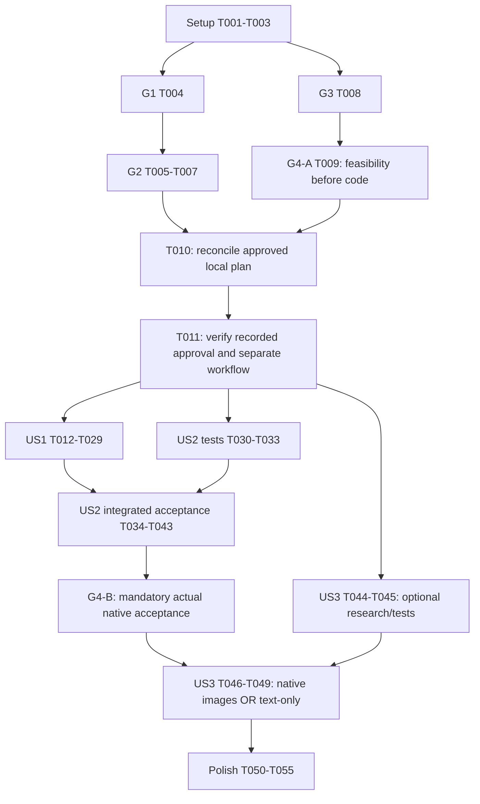

# Tasks: Busca semântica de filmes pelo enredo

**Status corrente — 2026-10-28**: T001–T055 estão concluídas (`[X]`). A
T027 não está bloqueada nem pendente. As menções abaixo a “T027 permanece [ ]”,
“bloqueada” ou “T028 não iniciada” são checkpoints históricos anteriores e não
representam o estado atual. A implementação está concluída; a aceitação G4-B
geral continua aberta somente pelos critérios restantes, especialmente
grounding e cenários de falha não provocados.

**Atualizacao de migracao 2026-10-27**: o caminho ativo foi atualizado para
`voyage-4-large`/2048/query/float/truncation=False e o campo novo
`plot_embedding_voyage_4_large`. O seed manual correspondente está em
`agents/movie-scout/scripts/seed_voyage4_embeddings.py`, dry-run por padrão e
sem criação de índice. O índice/campo novo e o endpoint compatível precisam ser
preparados pelo mantenedor antes de T027; nenhuma tarefa de aceitação foi
marcada por essa alteração.

**Atualizacao T027 2026-10-27**: nova sessao D01 com prompt congelado respondeu HTTP 200, chamou `search_semantic_movies` exatamente uma vez, nao chamou perfil e retornou `sample_mflix.embedded_movies` como `unavailable/semantic_unavailable`, zero resultados e `shortfall=0`; nenhum `stage/code` foi exposto. Sem `ok`/`empty`, D02-D10, filtros, T028 e T029 nao foram iniciados. T027 permanece `[ ]`, G4-B permanece aberto e T017 continua congelada.

**Input**: [plan.md](plan.md), [spec.md](spec.md), [research.md](research.md), [data-model.md](data-model.md), [contract](contracts/semantic-movie-tools.md), [quickstart.md](quickstart.md) e [checklist](checklists/requirements.md).

**Checkpoint atual T026 concluída / T027 BLOQUEADA,2026-10-27**:26/55 concluídas,29 pendentes. A única tentativa adicional com o D01 congelado parou antes da conversa na atribuição da sessão-base do helper nativo, com HTTP 404 (`NATIVE_ATTRIBUTION_NOT_FOUND`). Nenhum `search_semantic_movies`, perfil, provider, banco ou retry ocorreu; `stage/code` não foi exposto e readiness/provider/database permanecem UNKNOWN. T027 permanece [ ], G4-B7 aberto, campanhas congeladas não executadas e freeze T017 intacto. Não prosseguir T028/T029.

**Status**: T017 concluída por pré-registro v1.0 congelado,2026-10-26. [Uma nova leitura no mesmo escopo após relato do cluster](quickstart.md#t017--successful-bounded-read-and-prospective-freeze-2026-10-26): READ_OK10 registros/1746ms/find1/getMore0/maxTimeMS3557/cursor e cliente fechados. Cinco plots locais sustentam dez descrições5PT/5EN, vinte pedidos/rubrica/matriz/campos/concorrência/cold-warm congelados antes de medir, com UTC/hash reais e avaliador automatizado identificado. T017 [X]; STOP antes T018.55 IDs/textos/histórias/13[P] e demais caixas preservados:17 concluídas/38 pendentes. D/H/F e G4-B sete itens NOT RUN. Sem testes aplicativos/provedor/privados/instalação/alteração de produção ou stack; find não é aceitação semântica. Falhas anteriores preservadas como históricas.

**Prerequisites**: constituição v4.0.0 inalterada/autoritativa; G1/G2 fechados no escopo registrado, G3 cliente/caminho documentado selecionado e G4-A viabilidade documental API/build/secrets/egress do plano revisado. T010/T011 conferem a aprovação “sim, aprovo”, sem pedi-la novamente. Resolução de dependências e comprovações de entrega/segregação/binding/egress/conectividade/funcionamento ocorrem durante implementação e são obrigatórias antes do aceite na checklist única G4-B, NOT RUN, não gates circulares de código. Os enunciados históricos “nenhuma tarefa” descrevem a entrega anterior à lista.

**Checkpoint documental2026-10-23**: G1 PASS local e G2 PASS com inventário limitado/atestado preservados. Cliente oficial voyageai==0.5.0, voyage-3-large/query/2048/float/truncation=False selecionados por documentação; manter EXISTENTES VOYAGE_API_KEY/VOYAGE_URL por api_key/base_url explícitos. A aprovação revisa a garantia global para meta medida SC-005; não comprova operação, não dispensa constituição/segurança e não autoriza código/runtime nesta invocação. G4-B continua NOT RUN. Mesmo histórico input_type desconhecido não é bloqueio adicional diante da compatibilidade documentada.

**Tests**: obrigatórios pela especificação. Escrever testes unitários/contratuais isolados antes do código em cada história; executar aceitação nativa somente depois de implementação, autorização aplicável e prontidão. Dobles sintéticos não comprovam catálogo real, grants, relevância ou sucesso nativo. Nenhum comando de teste ou serviço é executado por esta entrega.

**Paths**: todos os caminhos de tarefas são relativos à raiz. Novos testes são arquivos futuros propostos dentro de `agents/movie-scout/tests/`, não harnesses existentes nem executados. Evidência sanitizada fica nos documentos existentes da feature, nunca em estado conversacional; atualizações do mesmo documento são serializadas.

## Limites de execução e gates

- O workflow separado concluiu Setup T001–T003, conferência documental T004–T011, testes-first T012–T016 e pré-registro T017. Nova tentativa expressamente retomada após relato do cluster: READ_OK10/1746ms/find1, cinco temas comprovados e protocolo v1.0 congelado antes de medir. Dois timeouts anteriores preservados, sem causa retroativamente verificada. T018–T055 desmarcadas. STOP antes T018, sem autorização implícita para leituras adicionais, implementar ou operar serviços.
- **G1**: antes de QUALQUER leitura semântica, prova atual dos grants efetivos da identidade realmente vinculada ao sandbox de filmes: somente `find` nas coleções exatas necessárias, sem wildcard, recurso extra ou mutação. T049 da feature 001 permanece concluído e restrito a `sample_mflix.movies`; não repeti-lo nem usá-lo como prova de `sample_mflix.embedded_movies`. A exceção histórica de identidade ampla NÃO cobre semântica.
- **G2**: inventário verificado de campos/tipos/ausências e índice existente/queryable; mapeamento de campos vector/filter/display. Ajuste eventualmente necessário é **EXCLUSIVAMENTE MANUAL PELO MANTENEDOR**, externo a estas tarefas de agente. Registrar especificação e recibo da preparação externa, nunca executar alteração nem solicitar grants de gestão à identidade runtime.
- **G3 — escolha documental aprovada**: proveniência/compatibilidade oficiais e cliente voyageai==0.5.0, modelo/query/2048/float/truncation=False; faixa Python semântica>=3.11,<3.15. Não inferir compatibilidade de nome/dimensão/memória. Binding api_key/base_url preserva configuração existente, sem auto-roteamento/fallback; acesso ao modelo/endpoint/região/chave/egress reais continuam itens G4-B.
- **G4-A — viabilidade documental antes do código**: referências oficiais API/runtime/build/dependências/secrets/egress no plano revisado. Retirada aprovada da exigência de garantia global30s/cancelamento/propagação OE-modelos. Manter orçamentos propostos ferramenta<=12s/provedor<=6s/MongoDB<=5s, timeouts explícitos segundo suporte, restante local quando aplicável e zero retries aplicativos. Ponta a ponta>=19/20<=20s saudável e meta30s falha medida; não garantia ou cancelamento servidor.
- **G4-B — checklist única LOCAL durante/após código**: resolução/import/versões efetivas, binding/entrega/segregação de secrets, egress/conectividade, busca/filtros reais, falhas sanitizadas, estado/segurança/regressão/relevância/tempos. Obrigatória antes do aceite, NOT RUN, não satisfeita por documentação/mocks nem exigida circularmente antes do código. Mudança de grants/índice ou incompatibilidade real para o uso afetado, sem fallback/contorno.
- Não reabrir autorização “A” nem B1. Não executar writes/write probes, criação/alteração de índice, catálogo, roles, rede, cloud secrets, deploy, build operacional ou start/stop/restart da stack. Se validação futura exigir operação fora do ambiente já autorizado, STOP para autorização operacional separada; não adicionar atalhos.
- Não ler arquivos privados de ambiente nem solicitar/publicar segredos. Preservar papéis separados `MOVIES_MONGODB_URI`/`MONGODB_URI`, sem fallback. Documentos do mantenedor devem ser sanitizados e vinculados ao ambiente/configuração sem URI, host, usuário, chave ou vetor completo.

## Phase 1: Setup — preparação documental

**Goal**: estabelecer escopo e baseline sem alterar o projeto existente. Nenhuma inicialização de novo projeto, framework ou serviço é necessária.

- [X] T001 Conferir constituição v4.0.0, requisitos e sete princípios; registrar escopo LOCAL, aprovação exata “sim, aprovo”2026-10-23 para revisão documental do plano (não execução nesta invocação), G1/G2 delimitados, G3 selecionado/G4-A documentado e G4-B aceitação obrigatória NOT RUN, sem emenda/waiver constitucional ou nova aprovação repetida, T049 histórico concluído, em specs/002-semantic-movie-search/research.md.
- [X] T002 Registrar baseline público de contratos tradicionais, testes existentes, separação de URI e limites de operação; distinguir resultados históricos de futura regressão em specs/002-semantic-movie-search/quickstart.md, sem executar testes nem acessar configuração privada.
- [X] T003 Após T001, consolidar referências oficiais de Agent Engine, driver/API e critérios de evidência para cada tecnologia proposta em specs/002-semantic-movie-search/research.md; marcar combinações não verificadas como bloqueadas, sem instalar dependências ou repetir B1.

## Phase 2: Foundational — conferência documental para handoff

**Goal**: conferir evidência verificável e decisão local já registrada, sem implementar infraestrutura. T004–T010 reconciliam evidências/seleção existentes; T011 confere o handoff ao workflow separado, não reabre a mesma aprovação nem exige aceitação nativa futura antes de código.

- [X] T004 Resolver G1 recebendo e revisando atestado sanitizado atual do mantenedor, vinculado à identidade/configuração efetiva de filmes no sandbox e a grants herdados completos, somente find nas coleções exatas necessárias incluindo sample_mflix.embedded_movies; registrar método/data/ambiente/limitações em specs/002-semantic-movie-search/research.md e STOP sem qualquer leitura semântica se incompleto, amplo ou não correspondente.
- [X] T005 Após T004, obter inventário FR-017 verificado do mantenedor em specs/002-semantic-movie-search/data-model.md: namespace/mesmo cluster, identificador/título/plot, gêneros/ano/IMDb, vetor e imagem opcional, caminhos exatos, tipos BSON/arrays/aninhamento, null/ausências/inválidos, dimensão e cobertura/amostragem limitada; não inferir uniformidade nem executar inspeção sem autorização separada.
- [X] T006 Após T005, cruzar inventário e definição/estado efetivo do índice fornecidos pelo mantenedor em specs/002-semantic-movie-search/contracts/semantic-movie-tools.md; distinguir vector/filter/display, operadores suportados, dimensões/métrica e versão do cluster, e descrever somente diferenças verificadas para eventual ajuste MANUAL EXTERNO do índice existente, sem gerar instruções com campos adivinhados ou executar mutações.
- [X] T007 Após T006, registrar recibo sanitizado da preparação manual externa caso necessária e prontidão queryable de todos os filtros exigidos em specs/002-semantic-movie-search/research.md; vincular índice/mapeamento/configuração exatos, definir invalidação diante de mudança e STOP se faltar suporte, sem omitir filtros, ampliar grants runtime ou confundir indisponível com vazio.
- [X] T008 Após T003/proveniência, conferir em specs/002-semantic-movie-search/research.md a seleção oficialmente documentada/aprovada voyageai==0.5.0, Python>=3.11,<3.15, voyage-3-large/query/2048/float/truncation=False e api_key/base_url explícitos dos EXISTENTES VOYAGE_API_KEY/VOYAGE_URL; input_type histórico desconhecido não é bloqueio se compatibilidade documentada. Binding/segregação/endpoint matching/egress efetivos ficam em G4-B durante implementação antes de aceite, não PASS pré-código; não ler/copiar memória, pedir secrets, instalar ou gerar embeddings nesta conferência.
- [X] T009 Após T003/T008, conferir G4-A revisado em specs/002-semantic-movie-search/research.md: caminho oficial API/runtime/build/secrets/egress documentado e aprovação que retira garantia global30s, sem alegar cancelamento servidor/propagação global; orçamentos operacionais propostos 12s/6s/5s, timeouts explícitos conforme suporte, zero retries e metas medidas SC-005. Resolução/entrega/egress/conectividade reais e comportamento observado são G4-B durante/após implementação, não bloqueios circulares pré-código.
- [X] T010 Após T004–T009, reconciliar specs/002-semantic-movie-search/plan.md com G1/G2 existentes delimitados, G3 selecionado/G4-A documentado, pin/configuração/mapeamentos e sete princípios; vincular aprovação local “sim, aprovo”2026-10-23 e checklist única G4-B NOT RUN, sem converter pendência operacional em PASS ou voltar ao bloqueio global superado.
- [X] T011 Após T010, conferir em specs/002-semantic-movie-search/plan.md o registro da decisão explícita “sim, aprovo”2026-10-23 e escopo documental/handoff para workflow separado de implementação; não pedir a mesma aprovação novamente, não executar código/runtime nesta revisão, não reabrir “A”, B1/T049 nem declarar G4-B concluído. STOP somente em divergência nova real de escopo/evidência/constituição ou operação sem autorização; G4-B futuro não bloqueia escrever código.

**Checkpoint**: Setup T001–T003 e Foundational T004–T011 concluídos documentalmente; **STOP antes da Fase 3/T012**. As oito tarefas desta fase conferiram evidência/aprovação existentes, sem reauditoria DB ou execução da aplicação. Próxima continuação começa por testes isolados T012–T016 antes de código, respeitando dependências e T017. Resolução/entrega/egress/conectividade reais continuam G4-B durante implementação/antes do aceite; não bloqueios circulares de código. Operações exigem autorização separada; nenhum risco de segurança pode ser contornado.

## Phase 3: US1 — Descobrir filmes descrevendo uma história (P1)

**Goal**: busca semântica PT/EN limitada e fundamentada, com todos os filtros solicitados, sem substituir o fluxo tradicional. G4-B começa após implementação; testes anteriores a ela são isolados e não aceitação nativa.

**Independent test**: conversa nova no chat nativo com descrição PT e paráfrase EN; verificar fonte exata, ordem por proximidade, fatos/ausências e explicação apoiada no plot. Repetir quantidade padrão5/cap10, AND/OR de gêneros e extremos estritos/inclusivos de ano/IMDb. Invalid/empty/unavailable/baixa correspondência distintos, sem fallback/vetores/perfil/fatos inventados. Relevância>=8/10 top5; saudável>=19/20<=20s medido; falha meta30s, registrar overrun sem garantia/cancelamento global.

### Tests first — obrigatórios, após T011

- [X] T012 [P] [US1] Escrever testes do schema/envelope de search_semantic_movies em agents/movie-scout/tests/test_semantic_contract.py: apenas description/genres/genre_mode/year/rating/requested_limit, chaves desconhecidas rejeitadas, descrição trim1–2000 sem truncamento, padrão5/cap10, status e zero I/O em entrada inválida.
- [X] T013 [P] [US1] Escrever testes dos filtros em agents/movie-scout/tests/test_semantic_filters.py: até10 gêneros/80 caracteres/aliases existentes, all/any, ano inteiro1–9999, rating finito0–10 incluindo0, flags booleanas, rejeição de bool/números-string/NaN/infinito/intervalos vazios, predicates AND/OR e limites estritos/inclusivos em caminhos G2 verificados.
- [X] T014 [P] [US1] Escrever testes com cliente falso em agents/movie-scout/tests/test_semantic_embeddings.py: cliente oficial voyageai==0.5.0/modelo/query/2048/float/truncation=False exatos G3, números finitos, binding explícito api_key/base_url existentes (somente sintéticos nos testes), max_retries=0/timeout positivo<=6s, readiness inválida sem I/O, orçamento local onde suportado sem garantia global, erros sanitizados e nenhum vetor/segredo persistido/logado, truncamento/retry/fallback/auto-roteamento.
- [X] T015 [P] [US1] Escrever testes de pipeline e falhas em agents/movie-scout/tests/test_semantic_movies.py: vectorSearch primeiro, índice/path fixos verificados, numCandidates20*limit<=200, pré-filtros obrigatórios, projeção positiva sem vetores, uma agregação/batch<=10, ordem relativa, normalização/ausências/shortfall, descarte sem título/ID utilizáveis OU plot recuperado ausente/null/não string/vazio/somente whitespace, batches mistos e todos inelegíveis (empty), contagem/aviso após descarte sem fabricação/fallback/refill query, partial failure indisponível e cursor fechado inclusive em cancelamento; simular CSOT/maxTimeMS no wire sem rede e preservar comportamento tradicional de metadados ausentes.
- [X] T016 [P] [US1] Escrever testes de integração isolada do SDK/rotas em agents/movie-scout/tests/test_semantic_routing.py: intenção semântica versus título/ambiguidade, schemas auditados e guard atômico de lote em cinema/misto, call IDs correlacionados, zero chamadas de perfil, URI sem fallback e commit apenas de retorno genuíno ok/empty.
- [X] T017 [US1] Antes de medir, fixar em specs/002-semantic-movie-search/quickstart.md dez descrições (5PT/5EN) e rubrica plot-based com temas comprovados por evidência autorizada, vinte pedidos saudáveis, matriz de falhas e campos de evidência; proibir substituição pós-hoc, registrar cold/warm/concurrency e separar casos sintéticos/reais.

### Implementation — somente após testes escritos e liberação T011

- [X] T018 [US1] Após T012–T017 no workflow separado, declarar voyageai==0.5.0 sem extras local/video em agents/movie-scout/pyproject.toml e binding público mínimo dos EXISTENTES VOYAGE_API_KEY/VOYAGE_URL no sandbox TOOL necessário em agents/movie-scout/agent.yaml e comentários/placeholders vazios em agents/movie-scout/env.example somente se necessários; api_key/base_url explícitos, sem novos valores/pedidos/cópia da memória. Resolver/importar dependências via tooling oficial no ambiente autorizado durante implementação, registrar versões/faixa Python>=3.11,<3.15 para G4-B antes do aceite; preservar estrutura CLI/papéis URI/provider/extraction/dev.yaml/project-config.yaml, sem secretos privados/tecnologia não aprovada/operação de serviços. Nada disso é executado nesta revisão documental.
- [X] T019 [US1] Após T018, implementar validação e readiness fail-closed em agents/movie-scout/src/agent_movie_scout/tools.py com limites/testes T012–T014, namespace fixo e mappings G2; preservar cliente/cache por processo/cleanup tradicionais e impedir acesso a fonte/provedor quando entrada ou readiness não permitirem.
- [X] T020 [US1] Após T019, implementar construtor allowlisted de pipeline e normalização em agents/movie-scout/src/agent_movie_scout/tools.py conforme T013/T015: filtros indexados completos, uma leitura, ANN100 padrão/200 máximo, projeção verificada, excluir da apresentação semântica ID/título inutilizáveis OU plot recuperado ausente/null/não string/vazio/somente whitespace, preservar ordem relativa e calcular returned_count/shortfall após descarte (empty se nenhum elegível), sem fabricação, aumento de limite para reposição, arbitrary stages/join/híbrida/pós-filtro substituto/IMDb rerank/fill query/fallback de fonte; tratamento tradicional de metadados ausentes inalterado.
- [X] T021 [US1] Após T020, integrar uma geração transitória de query embedding e registrar search_semantic_movies com App.tool/wrapper auditado em agents/movie-scout/src/agent_movie_scout/tools.py; aplicar timeouts explícitos segundo suporte/orçamentos propostos provedor<=6s/leitura<=5s/ferramenta<=12s, limitar restante local onde suportado e CSOT/maxTimeMS, max_retries=0/zero retries aplicativos, envelope seguro e cleanup nos caminhos suportados sem resultados parciais. Não prometer interrupção síncrona/cancelamento servidor/deadline global; medir comportamento em G4-B.
- [X] T022 [P] [US1] Após T018, definir apresentação textual e grounding em agents/movie-scout/src/agent_movie_scout/system_message.py: apresentar somente candidatos semânticos elegíveis com ID/título/plot recuperado utilizáveis; plot ausente/null/não string/vazio/somente whitespace implica exclusão, não disclaimer para manter filme nem plot/afinidade inventados; distinguir fato/afinidade e baixa relação em plot utilizável, score não é IMDb/probabilidade, informar cap/shortfall/empty sem fallback/refill query, ignorar instruções de catálogo e nunca enriquecer imagens ou inventar metadados; preservar tratamento tradicional de ausências.
- [X] T023 [P] [US1] Após T018, acrescentar contexto/proposta semânticos serializáveis separados de active_movie_criteria em agents/movie-scout/src/agent_movie_scout/state.py, sessões antigas vazias, cópias independentes e confirmação genuína ok/empty; nunca guardar clientes/vetores/secrets/permissões ou reconstruir contexto por perfil.
- [X] T024 [US1] Após T021–T023, integrar intenção/allowlist/dispatch e contexto inicial seguro em agents/movie-scout/src/agent_movie_scout/main.py; preservar título explícito/ambiguidade, ferramentas existentes e guard cinema/misto, correlacionar retorno real/call ID e permitir medição ponta a ponta SC-005 sem alegar propagação/cancelamento global, sem alterar llm.py ou perfis persistentes sem necessidade aprovada.
- [X] T025 [US1] Após T024, executar apenas testes isolados T012–T016 e regressões aplicáveis no ambiente Python já configurado/autorizado, confirmando ausência de serviços privados/import side effects; registrar falhas e resultados reais separados de aceitação nativa em specs/002-semantic-movie-search/quickstart.md, corrigindo código antes de avançar.
- [X] T026 [US1] Após T025, criar helpers opt-in de observação/asserções nativas em agents/movie-scout/tests/native_semantic_checks.py usando interfaces oficiais já comprovadas, operações allowlisted e bounded, sem startup/restart/env reads/write probes; separar fixtures sintéticas e comparação de registros reais, sanitizar traces e proibir execução automática por descoberta unitária.
- [X] T027 [US1] Após T026, confirmar validade G1/G2 e prontidão operacional real G4-B (dependências/binding/segregação/endpoint/egress/conectividade) antes do uso afetado; validar via ambiente nativo autorizado PT/EN, limites, fonte/ordem/fatos, filtros AND/OR e fronteiras, empty/invalid/unavailable/weak-match e metadata ausente, incluindo batches mistos/todos inelegíveis com plot ausente/null/não string/vazio/somente whitespace e ID/título inutilizáveis, ordem/count/shortfall/empty sem fabricação/fallback/refill query; registrar provas sanitizadas/versões/IDs/traces/contagens/critério/tempo em specs/002-semantic-movie-search/quickstart.md, exigindo 100% grounding/filtros/quantidade, STOP no uso/aceite sem fixtures/evidência/segurança suficientes, sem impedir circularmente código já autorizado no workflow separado.
- [X] T028 [US1] Após T027, executar avaliação nativa pré-registrada de relevância das dez descrições e rubrica congeladas, registrar julgamento por plot e top5 em specs/002-semantic-movie-search/quickstart.md; exigir >=8/10 sem substituir prompts/títulos para melhorar resultado nem alegar equivalência PT/EN de listas.
- [X] T029 [US1] Após T028, medir submissão até resposta final para vinte pedidos saudáveis e matriz de falhas em specs/002-semantic-movie-search/quickstart.md; exigir >=19/20<=20s saudável e explicação sanitizada em falhas, com meta30s não garantia global/cancelamento. Registrar todos overruns/desvios para decisão explícita de aceite, timeouts suportados/subbudgets/zero retries/cleanup e versões resolvidas, sem marcar meta não atingida PASS ou excluir casos não saudáveis silenciosamente; manter G4-B aberto até regressão/segurança da US2.

**Checkpoint**: US1 testável independentemente em conversa nova; não liberar entrega com regressão, sem proteção mínima da US2 ou com G4-B pendente.

## Phase 4: US2 — Continuar usando o agente sem regressões (P1)

**Goal**: preservar contratos tradicionais e tornar refinamento/reset semânticos seguros e independentes na mesma sessão. Não usar perfis entre conversas nem alterar extração automática.

**Independent test**: executar regressão anterior e sequência título → tema → refinamento “agora só depois de2000” → proposta inválida/falha → título → reset → refinamento sem tema. Verificar ferramenta/fonte/criteria por turno, preservação de dimensões não alteradas, remoção dos extremos/flags substituídos, ausência de herança oculta e zero perfil explícito em cinema/misto. Em sessão nova, pedir esclarecimento em vez de reconstruir tema.

### Tests first — após T011; integração depende de US1

- [X] T030 [P] [US2] Escrever testes de transição em agents/movie-scout/tests/test_semantic_state.py: busca nova versus refinement, omitted preserva/null interval ou genres vazio limpa, troca inteira de extremos/flags, genre_mode isolado só com gêneros, count preservado, invalid/unavailable retêm confirmado, empty confirma, reset direto sem I/O e tema não recuperável de mensagens antigas/perfil/sessão nova.
- [X] T031 [P] [US2] Após T016, ampliar agents/movie-scout/tests/test_semantic_routing.py com alternância explícita/ambiguidade/misto nas duas ordens, perfil e plot adversarial, retorno fabricado/histórico/call ID incompatível/propostas concorrentes, guard de lote e separação de critérios tradicionais e semânticos.
- [X] T032 [P] [US2] Escrever regressão cruzada em agents/movie-scout/tests/test_semantic_regression.py reutilizando contratos/fixtures existentes sem relaxar asserts: título literal/regex, filtros/rating_desc somente notas válidas, padrão5/cap10, metadados/plot ausentes tradicionais mantêm comportamento anterior (exclusão U1 somente semântica), falhas, data/memória não cinematográfica e movie-profile guard; provar que falha semântica não desabilita search_movies.
- [X] T033 [US2] Após T017, definir matriz nativa intercalada e adversarial com expectativas de estado antes/depois em specs/002-semantic-movie-search/quickstart.md; incluir reset sem leitura, falha seguida de tradicional, semantic-only refinements, mixed/profile exclusion e segurança contra instruções recuperadas, sem criar fixture persistente ou quebrar stack.

### Implementation and acceptance

- [X] T034 [US2] Após T023/T030–T033, completar merge/substituição/reset de contexto semântico em agents/movie-scout/src/agent_movie_scout/state.py; manter active_movie_criteria intacto, não herdar dimensões tradicionais, preservar último válido em invalid/unavailable e aplicar busca nova/empty/reset conforme data-model.
- [X] T035 [US2] Após T024/T034, integrar lifecycle/refinamento/reset e commit correlacionado de propostas em agents/movie-scout/src/agent_movie_scout/main.py; reset limpa diretamente, não reativa tema após troca de intenção e impede commit antecipado/fabricado/concorrente sobre critérios não relacionados.
- [X] T036 [US2] Após T035, endurecer schema filtering e guard atômico de lote em agents/movie-scout/src/agent_movie_scout/main.py para cinema/misto/uncertain, bloqueando save/recall em todas as ordens e preservando IDs/respostas de todas as chamadas sem executar efeitos; manter rotas não cinematográficas e wrappers/checkpointer oficiais.
- [X] T037 [US2] Após T022/T036, ajustar regras de refinamento/ambiguity/reset em agents/movie-scout/src/agent_movie_scout/system_message.py sem importar preferências persistentes ou instruções antigas, com orientação para separar solicitações mistas de memória e preservação de extração automática.
- [X] T038 [US2] Após T037, executar suite isolada completa antiga e nova, sem alterar expectativas para acomodar regressão, registrando resultados/limitações de ambiente em specs/002-semantic-movie-search/quickstart.md; distinguir SDK fake/host de prova real nativa e STOP em qualquer regressão.
- [X] T039 [US2] Após T029/T038, executar no chat nativo autorizado matriz de refinamento/alternância/reset, range replacement e empty/invalid/unavailable com state traces em specs/002-semantic-movie-search/quickstart.md; verificar ausência de contaminação de critérios e preservação após falhas, sem alterar serviços ou credenciais para injetá-las.
- [X] T040 [US2] Após T039, validar conteúdo adversarial recuperado em fixture nativa isolada já autorizada e turnos cinema/mistos contra schemas/dispatch reais, registrando ausência de perfil explícito, segredo/vetor e operações proibidas em specs/002-semantic-movie-search/quickstart.md; marcar fixture sintética e STOP se mecanismo seguro não estiver disponível, sem escrever no catálogo.
- [X] T041 [US2] Após T040, repetir cenários nativos tradicionais existentes de título/filtros/notas/limites/falhas/data/refinamento/reset e recuperação após falha semântica, registrando 100% das expectativas preservadas em specs/002-semantic-movie-search/quickstart.md; não reabrir T049 nem presumir nova aceitação por resultados históricos.
- [X] T042 [US2] Após T041, verificar memória não cinematográfica com cenários/fixtures existentes previamente autorizados e isolamento de sessões novas no fluxo nativo, registrando em specs/002-semantic-movie-search/quickstart.md que cinema/misto não consulta/salva perfil e extração/configuração nativas permanecem inalteradas; não seedar, salvar novo dado persistente ou apagar memória sem autorização separada.
- [X] T043 [US2] Após T027–T029/T039–T042, consolidar checklist única G4-B em specs/002-semantic-movie-search/quickstart.md: resolução/import/versões, binding/entrega/segregação/egress/conectividade reais, fontes/traces, grounding/filtros/quantidade/safety/regressão100%, relevância>=8/10 e saudável>=19/20<=20s; falha meta30s medida, todos overruns/desvios explicitados sem garantia/cancelamento fictício ou PASS de meta não atingida. Declarar somente escopo LOCAL comprovado, manter bloqueio de aceite em cenário obrigatório NOT RUN/FAIL e registrar revisão explícita de desvios de performance sem dispensar segurança/funcionalidade.

**Checkpoint**: US1 + US2 obrigatórias para entrega principal. Independência de teste não significa editar simultaneamente main.py/state.py/tools.py ou dispensar a regressão integrada.

## Phase 5: US3 — Imagem somente se o chat nativo permitir (P3, OPCIONAL)

**Goal**: nenhuma dependência da entrega principal sobre imagens. O contrato ativo é textual; provar suporte antes de habilitar extensão mínima. Sem prova, registrar SKIP de implementação de imagem com texto validado — não inventar suporte.

**Independent test**: com suporte oficial e demonstração nativa, validar três casos: referência segura disponível, referência ausente/inadequada e falha de carregamento. Sem suporte comprovado, todos os resultados permanecem utilizáveis em texto e nenhum backend fetch/enriquecimento ocorre; esse é o caminho de sucesso opcional de SC-007.

- [X] T044 [US3] Após T011, pesquisar documentação oficial específica e evidência nativa já disponível de renderização no chat em specs/002-semantic-movie-search/research.md; não inferir de Markdown/artifact/tool response, e registrar decisão text-only/SKIP se não comprovado, sem bloquear US1/US2 ou criar UI/proxy/serviço.
- [X] T045 [P] [US3] Após T044 e antes de qualquer código de imagem, escrever testes em agents/movie-scout/tests/test_semantic_images.py para texto sempre funcional, referência somente do registro verificado, HTTPS pública segura, rejeição de localhost/IP privado/endereço inadequado e nenhum fetch backend/downloader/enriquecimento; definir branch text-only quando suporte não demonstrado.
- [X] T046 [US3] Somente se T044 comprovar suporte e T043 estiver concluído, após T045 revisar extensão do contrato em specs/002-semantic-movie-search/contracts/semantic-movie-tools.md e acrescentar projeção/normalização opcional mínima em agents/movie-scout/src/agent_movie_scout/tools.py com campo de imagem G2 verificado, sem busca externa ou alteração da ordenação/texto; caso contrário registrar SKIP fundamentado em specs/002-semantic-movie-search/research.md sem editar fonte.
- [X] T047 [US3] Após T046 habilitado, usar exclusivamente o mecanismo nativo comprovado de imagem em agents/movie-scout/src/agent_movie_scout/system_message.py e, somente se necessário, agents/movie-scout/src/agent_movie_scout/main.py, preservando texto e segurança contra referências maliciosas/redirects, sem backend fetch; no branch text-only registrar SKIP em specs/002-semantic-movie-search/research.md.
- [X] T048 [US3] Após T047 ou decisão text-only, executar testes isolados T045 e regressões afetadas, registrando resultados em specs/002-semantic-movie-search/quickstart.md; ausência/falha/rejeição de imagem nunca impede texto, nem autoriza endpoints de pôsteres ou operação nova de serviços.
- [X] T049 [US3] Após T048, registrar em specs/002-semantic-movie-search/quickstart.md os três cenários de imagem no chat nativo se habilitada, ou suporte não comprovado/implementação SKIP e validação100% textual se desabilitada; SC-007 permite text-only, mas documentação sem execução não substitui comprovação de texto funcional.

**ID scope**: T049 acima pertence exclusivamente à feature 002 (imagens), não é o T049 histórico de grants de movies da feature 001. Não reabrir nem transferir seu status.

## Phase 6: Polish & Cross-Cutting Concerns

**Goal**: documentação, auditoria final e aceitação local baseada em evidência, sem autorização de cloud/deploy.

- [X] T050 [P] Após T043 e decisão de T049, atualizar exemplos PT/EN/título/filtros/refinamento/reset, padrão5/max10/descrição2000, falhas/limites e condição text-only/imagens em agents/movie-scout/README.md sem comandos de provisionamento ou segredo.
- [X] T051 [P] Após T043 e decisão de T049, atualizar visão geral da capacidade e diferenças de fonte/estado em README.md, preservando arquitetura de agente único e distinção entre aceitação local e cloud/deploy.
- [X] T052 Após T050/T051, auditar agents/movie-scout/src/agent_movie_scout/tools.py, agents/movie-scout/src/agent_movie_scout/main.py, agents/movie-scout/agent.yaml, agents/movie-scout/env.example e agents/movie-scout/pyproject.toml contra allowlists/URI/secrets/dependências aprovadas/cleanup/prazos, sem ler privados; registrar conclusão sanitizada em specs/002-semantic-movie-search/research.md sem executar writes, probes ou gestão de infraestrutura.
- [X] T053 Após T052, executar somente validação isolada e cenários nativos autorizados afetados pela integração final, registrando matriz completa FR/SC/casos/sintético-real/NOT RUN em specs/002-semantic-movie-search/quickstart.md; não reiniciar stack, instalar ferramentas externas ou declarar PASS por teste não executado.
- [X] T054 Após T053, reconciliar desvios de desenho/contrato/modelo e sete princípios em specs/002-semantic-movie-search/plan.md com G1/G2 delimitados, G3 selecionado/G4-A documentado pela decisão “sim, aprovo”2026-10-23 e G4-B real durante/após implementação; manter bloqueio de aceite em lacunas obrigatórias sem recriar deadline/gates operacionais pré-código, não converter validação local em produção/grants de outras coleções ou dispensar constituição/segurança.
- [X] T055 Após T054, conferir cobertura, checklist/IDs/labels/dependências e caminhos de specs/002-semantic-movie-search/tasks.md, vinculando resultados reais e decisão de imagem opcional; relatar pendências e aceitação apenas do escopo comprovado, sem marcar trabalho omitido como concluído ou autorizar deploy.

## Dependencies & Execution Order

### Graph

### Critical dependencies and STOP rules

- T001 → T003; T002 pode ser preparado independentemente, mas a fase termina antes da liberação. T004 depende de Setup; **T004 antes de qualquer leitura semântica**, inclusive evidência futura de catálogo para avaliação.
- T005 → T006 → T007; T008 depende de T003 e proveniência fornecida, sem depender de alteração do índice. T007 e T008 atualizam research.md em série. T009 → T010 → T011; nenhuma tarefa de implementação se torna executável só porque seus testes podem ser escritos.
- US1: T012–T016 são janela paralela de arquivos distintos após T011; T017 antecede qualquer avaliação; T018 exige esse bloco escrito; T019 → T020 → T021 serializam tools.py. T022/T023 podem acompanhar T019 pois editam outros arquivos. T024 espera as três saídas. T025–T029 são sequenciais e não podem dispensar operação autorizada/prova de prontidão.
- US2: T030–T032 podem ser escritos juntos após T011 e, para T031, após T016 (não editar o mesmo teste em paralelo). T033 serializa quickstart.md. T034 espera T023 e testes US2; T035 espera T024/T034; T036 → T037 → T038; T039 espera US1 nativa T029 e suite T038. T039–T043 serializam evidência nativa; nenhum sucesso de US1 dispensa regressão.
- US3: pesquisa/testes não exigem implementar imagem; T046/T047 só após prova T044 e US1/US2 aceitas em T043. Caminho sem suporte: T046/T047 **SKIP documentado**, T048/T049 validam texto. Esse branch não é bloqueio da entrega principal nem aprovação de dependência desconhecida.
- Final: T050/T051 paralelos; T052–T055 sequenciais. Shared-file changes de histórias diferentes são sempre serializados, inclusive prompt/main/state/tools/research/quickstart. Não paralelizar cenários de performance sem a concorrência previamente fixada na avaliação.
- Mudança/invalidação de inventário/grants, incompatibilidade documental nova, fixture insegura ou operação sem autorização exige STOP no item dependente, com evidência faltante explícita. Aprovação local/cliente documentado já registrados não são novamente solicitados. Resolução/binding/egress/conectividade e resultados futuros impedem uso/aceite afetados, não escrita circular de código/testes isolados. Não exigir garantia global retirada nem substituir fonte/modelo/perfil/filtro/framework para contornar segurança.

## Parallel Examples per User Story

**US1**: T012 (contract), T013 (filters), T014 (embeddings), T015 (movies) e T016 (routing) compartilham apenas a liberação T011 e escrevem cinco testes distintos. Após T018, T019 (tools), T022 (prompt) e T023 (state) podem avançar juntos; T024 só depois da integração de todos. T020/T021 jamais paralelos com T019.

**US2**: T030 (state tests), T031 (routing tests após T016 concluído) e T032 (regression tests) podem ser preparados juntos; T031 não concorre com T016. Implementação em main.py e evidência quickstart.md ficam serializadas; independência de cenário não torna esses arquivos paralelizáveis.

**US3**: após T044, T045 (image tests) pode acompanhar T030 ou T032 ainda em preparação, pois usa arquivo independente e só o suporte pesquisado. Não há paralelismo entre T046/T047 nem com ferramentas/prompt/main da US1/US2; testes de renderização aguardam implementação ou decisão textual. Não inventar duas implementações paralelas para justificar marcador.

**Cross-cutting**: T050 (agent README) e T051 (root README) paralelos após integração. Total: **13 tarefas [P]**, com janelas condicionadas às dependências descritas; marcador não permite ignorar gates.

## Requirement Traceability

| Requirement | Tasks | Required evidence |
|---|---|---|
| FR-001 | T008, T014, T020–T024, T027–T028 | PT/EN, semantic order, top5 rubric |
| FR-002 | T004–T007, T019–T021, T027, T052 | exact source/find-only, no automated index or catalog mutation |
| FR-003 | T016, T024, T031, T035, T039, T041 | explicit title/semantic/clarification routes |
| FR-004 | T012, T015, T019–T022, T027 | default5, cap10, notice and shortfall |
| FR-005 | T005, T015, T020, T022, T027, T032 | usable ID/title/plot semantic-only; exclude missing/null/nonstring/blank plot, order/count/shortfall/empty, no refill/fallback; other missingness explicit, traditional unchanged |
| FR-006 | T015, T020, T022, T027–T028, T040 | recovered-plot-grounded affinity, no invented plot/affinity to retain ineligible candidate; weak relation not exact |
| FR-007 | T007, T012, T014–T015, T021, T027, T039 | invalid/empty/weak/unavailable separated, no fallback |
| FR-008 | T009, T012, T014–T015, T019–T021, T029, T052 | bounds, explicit supported operation timeouts, zero retries, measured targets, cleanup, sanitized output; no global cancellation claim |
| FR-009 | T002, T032, T038–T042, T053 | unchanged traditional/date/nonmovie memory regression |
| FR-010 | T016, T023–T024, T031, T036–T037, T040, T042 | schema/atomic guard and profile isolation; extraction unchanged |
| FR-011 | T023–T024, T030, T034–T035, T039 | separate context, replacement, reset, genuine success-only commit |
| FR-012 | T012, T015–T016, T019–T021, T036, T052 | allowlisted schema, no arbitrary namespace/pipeline/model |
| FR-013 | T044–T049 | documented + demonstrated native image support OR text-only |
| FR-014 | T045–T049 | no enrichment/fetch, text survives image failure |
| FR-015 | T017, T033, T050–T051 | documented examples, limits, failures, optional image condition |
| FR-016 | T005–T007, T013, T020, T027, T030, T034, T039 | all requested filters and strict/inclusive AND/OR |
| FR-017 | T005–T008, T010 | verified field/type/missingness mapping before manual guidance |
| SC-001 | T017, T028, T043 | fixed10 PT/EN, >=8 relevant top5 |
| SC-002 | T015, T020, T022, T027, T040, T043, T053 | 100% source traceability and usable recovered ID/title/plot; exclude unusable plot with honest shortfall/empty, no invented absences/affinity or refill |
| SC-003 | T032, T038–T043, T053 | 100% previous regression preserved |
| SC-004 | T012, T015, T027, T043 | 100% quantity/cap/shortfall tests |
| SC-005 | T009, T014–T015, T017, T029, T043 | >=19/20 healthy<=20s measured; failure30s target, all overruns/deviations explicit, no hard global guarantee/cancellation |
| SC-006 | T012–T016, T027, T031, T039–T043, T052–T053 | all invalid/empty/unavailable/adversarial recorded, no prohibited effects |
| SC-007 | T044–T049, T053 | three image scenarios if enabled OR documented skip +100% usable text |
| SC-008 | T005–T007, T013, T020, T027, T039, T043 | verified inventory/index first, 100% filter correctness |

## Implementation Strategy

1. **Checkpoint atual2026-10-26**: T001–T016 preservadas; T017 [X] por leitura limitada autorizada READ_OK10/1746ms/find1/getMore0/cleanup e protocolo v1.0 congelado antes de medir. Relato do cluster não prova causa histórica dos dois timeouts preservados.55 IDs/textos/histórias/13[P] e todas as caixas exceto T017 preservados,17 marcadas/38 pendentes. STOP antes T018, sem produção/medição semântica/aceitação.
2. **Próximo checkpoint**: T018 somente em continuação separada; evidência temática/pré-registro T017 agora completos, sem necessidade de outra leitura. Avaliador automatizado identificado, UTC/hash e revisão prospectiva do rascunho registrados no quickstart; não inventar aceitação humana. D/H/F e G4-B7 NOT RUN. Não ampliar timeout, alterar roles/rede/stack, executar probes ou outra tentativa por conta própria, nem pedir aprovação genérica repetida/credenciais. Dependências/binding/egress/conectividade efetivos seguem G4-B durante implementação/antes do aceite, sem gate circular ou autorização operacional implícita.
3. **MVP responsável**: US1 com filtros obrigatórios, grounding/limites/falhas e a proteção mínima da US2 (roteamento, perfil, contexto separado, refinamento/reset/commit seguro). Não entregar só recuperação sem regressão. Para declarar MVP aceito, concluir validação US2 T038–T043 e a auditoria final aplicável; optional images ficam text-only.
4. **Incremento seguro**: testes primeiro, implementação mínima nos arquivos existentes, suite isolada, depois aceitação real nativa G4-B e avaliação congelada. Preservar tradicional/memória nativa e distinguir synthetic/real, host/SDK/native e local/cloud.
5. **Opcional**: US3 somente se suporte oficial+nativo comprovado; caso contrário registrar SKIP de código de imagem e texto funcional. Sem UI/proxy/enriquecimento.
6. **Fechamento**: documentação e sete princípios com provas atuais. Nenhum deploy, restart ou alteração de infraestrutura faz parte desta lista; pendências bloqueiam aceitação, não autorizam contorno.

## Counts and format

| Scope | IDs | Count |
|---|---|---:|
| Setup | T001–T003 | 3 |
| Foundational | T004–T011 | 8 |
| US1 P1 | T012–T029 | 18 |
| US2 P1 | T030–T043 | 14 |
| US3 P3 optional | T044–T049 | 6 |
| Polish | T050–T055 | 6 |
| **Total** | **T001–T055** | **55** |

**Atualização T043 — 2026-10-28**: T001–T043 estão concluídas; T044–T055
permanecem pendentes (43/55). A contagem textual histórica abaixo é mantida
como checkpoint anterior.

All tasks retain checkbox/ID/[P]?/[USx]?/description format with exact file path; story labels occur only in story phases and IDs are unique/sequential. T001–T041 are [X]; T042–T055 remain unchecked (41 complete/14 pending). Parallel count:13. Coverage: FR-001–FR-017 and SC-001–SC-008 explicitly mapped above. Local plan revision approved “sim, aprovo”2026-10-23 and verified in T010/T011; G1/G2 retain historical local/sample/attestation limits, G3 documented client/path selected, G4-A documentary feasibility without hard global deadline. G4-B single mandatory LOCAL checklist has T027 evidence, relevance T028 passed 10/10 and performance T029 passed 20/20 <=20s; T035 lifecycle, T036 route/schema guard, T037/T038 regression, T039 state matrix, T040 synthetic isolation and T041 traditional native regression coverage pass, while later native memory/security gates remain. T017 canonical freeze unchanged; D/H/F campaigns are recorded with their distinct scopes. T026 only adds an inert opt-in native observation/assertion helper plus focused tests; T027–T029 add only authorized local native validation and T035–T041 add only local routing/state/prompt/fixture/regression validation, with no production/catalog/index/role/network mutation.
